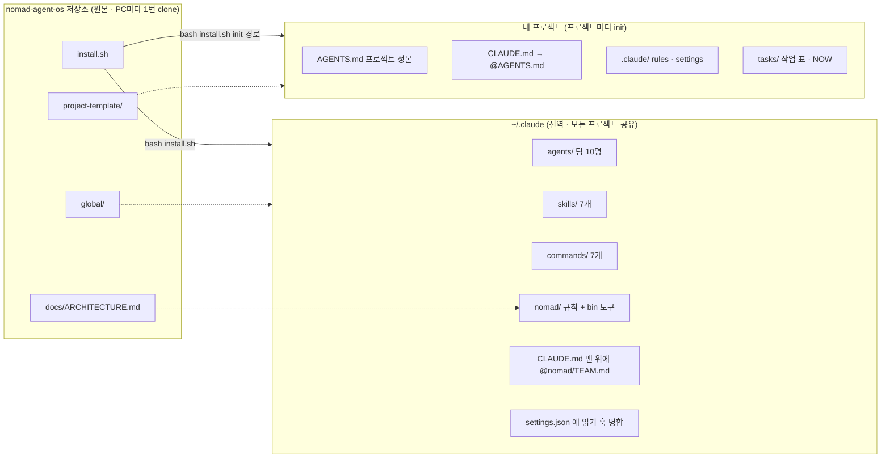
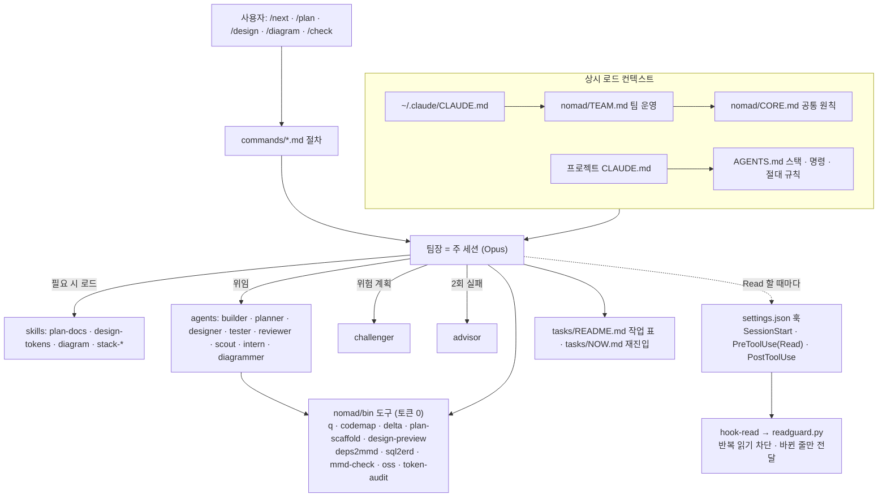

# NOMAD Agent OS

토큰을 아끼고 코딩·기획·디자인·다이어그램을 팀으로 처리하는 **Claude Code 멀티에이전트 최종 구조**.
4개 레포(platform-docs · tablet-kiosk-core · MultiAgent-Service-Fullstack-Tree-Framwork · Java-Service-Tree-Framework-Multi-Agent-Workspace)를 분석해 장점만 합쳤습니다.
설계 근거와 측정은 [`docs/ARCHITECTURE.md`](docs/ARCHITECTURE.md).

| | 기존 M | 기존 J | 기존 kiosk | **NOMAD Agent OS** |
|---|---|---|---|---|
| 상시 로드(추정 토큰) | 7,551 | 12,678 | 5,490 | **3,254** |
| 반복 읽기 차단 | ✗ | ✗ | ✗ | **훅으로 강제 + delta** |
| 그림·미리보기 생성 | 모델 | 모델 | 모델 | **스크립트(토큰 0)** |
| 오픈소스 도구·로컬 LLM | ✗ | ✗ | ✗ | **AGENTS.md 정본 + oss** |

## 설치 (macOS · Linux · Windows는 Git Bash)

**필요:** [Claude Code](https://claude.com/claude-code), git, Python 3.8+, (다이어그램 렌더링 시) Node.js — `npx`로 mermaid-cli 자동 사용.
Windows는 python.org 설치본을 쓰고, *설정 > 앱 > 앱 실행 별칭*에서 `python.exe`·`python3.exe` 스텁을 끄세요.

**1. 받기**
```bash
git clone https://github.com/DevOps0906/nomad-agent-os.git
cd nomad-agent-os
```

**2. 전역 설치** — 모든 프로젝트에서 같은 팀을 씁니다.
```bash
bash install.sh                 # ~/.claude: 팀 10명 · 스킬 7 · 명령 7 · 도구 12 · 훅
# 옵션: --no-path (PATH 등록 안 함), --codex (Codex CLI 전역 AGENTS.md에도 규칙 추가)
```
기존 `~/.claude/CLAUDE.md`·`settings.json`은 덮어쓰지 않고 한 줄 import·훅만 추가합니다. 같은 이름의 에이전트·스킬·명령은 백업 후 교체합니다(백업: `~/.claude/.nomad-backup/<시각>/`).
`~/.claude/nomad/bin`이 `~/.bashrc`(zsh면 `~/.zshrc`)의 PATH에 추가되니 **새 터미널**을 여세요.

> 1~2단계는 **PC마다 한 번**입니다. 새 프로젝트를 할 때마다 이 저장소를 다시 받지 않습니다.

**3. 프로젝트 적용** — 프로젝트마다 한 번. 어느 폴더에서 실행해도 됩니다.
```bash
bash ~/work/nomad-agent-os/install.sh init ~/work/내프로젝트                 # AGENTS.md 제목 = 폴더명
bash ~/work/nomad-agent-os/install.sh init ~/work/내프로젝트 --name "표시 이름"  # 제목 직접 지정
```
AGENTS.md · CLAUDE.md · rules · tasks를 복사합니다. 기존 파일은 보존·병합하고, `.git`과 원격 연결은 건드리지 않습니다(git 명령을 실행하지 않음).
그다음 `AGENTS.md`의 스택·명령·고유 규칙을 채우고, 프로젝트 폴더에서 `claude` 실행 → `/plan` 또는 `/next`.

- **이미 GitHub 저장소가 있으면:** 먼저 `git clone` → 그 폴더에 `init` → 추가된 파일을 커밋. (순서를 바꾸면 clone이 "폴더가 비어 있지 않음"으로 실패)
- **이 저장소 안의 경로는 거부됩니다.** 원본에 프로젝트 파일이 섞이지 않도록, 프로젝트는 항상 이 저장소 밖에 둡니다.

**4. 확인**
```bash
token-audit ~/work/내프로젝트    # 상시 로드 토큰 측정 (PATH 미등록 시 ~/.claude/nomad/bin/token-audit)
```
Claude Code에서 `/agents`를 열어 팀 10명이 보이면 끝입니다.

**업데이트:** 받은 폴더에서 `git pull && bash install.sh` — 다시 실행해도 훅·import는 중복 추가되지 않습니다.

| 언제 | 할 일 |
|---|---|
| PC마다 한 번 | 이 저장소 clone → `bash install.sh` (전역 설치) |
| 프로젝트마다 | `install.sh init <프로젝트 경로> [--name 이름]` 한 줄 |
| NOMAD 업데이트 시 | 이 저장소에서 `git pull && bash install.sh` |

> 팀(에이전트)·스킬·도구는 `~/.claude`에 있어 모든 프로젝트가 같이 씁니다. 프로젝트에는 그 프로젝트 전용 규칙 파일만 들어갑니다.

## 시작하기 — 두 가지 방식

### A. 이미 GitHub 저장소(코드)가 있을 때
```bash
cd ~/work
git clone https://github.com/<계정>/<저장소>.git                  # 1) 먼저 clone
bash ~/work/nomad-agent-os/install.sh init ~/work/<저장소>       # 2) 그 폴더에 init
cd <저장소> && claude
```
1. **`AGENTS.md`를 실제 코드에 맞추기 (가장 중요)** — 템플릿의 스택·명령(`pnpm dev` 등)은 예시입니다. `/check`·`/next`가 이 명령 표를 그대로 실행하므로 Claude에게 *"이 저장소를 분석해서 AGENTS.md의 스택·명령 표를 실제에 맞게 채워줘"*라고 맡깁니다.
2. **현재 구조 파악** — `/diagram 코드 구조도`(import 분석 → `docs/diagrams/architecture.mmd`), DB가 있으면 `/diagram erd`, `/check`로 린트·테스트가 도는지 확인.
3. **작업 표 만들기** — `/next`는 `tasks/README.md`를 따라 움직입니다(템플릿의 `task-001`은 예시). 새 기능이면 `/plan 기능명`, 작은 수정이면 *"tasks/README.md에 작업 등록해줘: ①… ②…"*.
4. **개발 반복** — `/next` → `/clear` → `/next` …
5. **커밋** — `git add -A && git commit -m "Add NOMAD agent config" && git push`

### B. 아무것도 없이 기획부터 시작할 때
```bash
bash ~/work/nomad-agent-os/install.sh init ~/work/<프로젝트> --name "<제품명>"   # 폴더가 없으면 생성
cd ~/work/<프로젝트> && git init -b main && claude
```
1. **기획** — `/plan <제품명>`: `docs/`에 문서 뼈대 8개(00_LEAN · 01_PRD · 02_ARCHITECTURE · 03_SCREENS_UX · 04_API · 05_DATA_MODEL · adr · diagrams) 생성.
   **00_LEAN(린 검증)부터** 진행하며, 통과 전에는 개발 작업을 만들지 않습니다. 제품 방향 질문만 사용자에게 묻고, 섹션은 planner들이 병렬로 채운 뒤 reviewer가 점검합니다. 마지막에 `tasks/task-NNN.md`가 자동 생성됩니다.
2. **그림 (선택)** — `/diagram 회원가입 흐름` · `/diagram 결제 시퀀스`
3. **디자인** — `/design`: 브리프(대상 · 주된 일 · 분위기 3단어 · 피할 것) → 시작 `tokens.css`(반응형 3구간 폰트) → **미리보기 HTML 자동 생성**. 브라우저로 보고 *"주색 더 진하게"*처럼 요청하면 토큰만 수정됩니다. **확정 전에는 화면 구현을 시작하지 않습니다.**
4. **`AGENTS.md` 확정** — *"기획 문서 기준으로 AGENTS.md 채워줘"*
5. **개발 반복** — `/next` → `/clear` → `/next` … (작업마다 자동 커밋)
6. **GitHub 연결** — `gh repo create <계정>/<프로젝트> --private --source . --push`

| 단계 | A. 저장소 있음 | B. 처음부터 |
|---|---|---|
| 준비 | clone → init | init → `git init` |
| 첫 작업 | `AGENTS.md`를 실제 코드에 맞춤 | `/plan`으로 기획 |
| 파악·설계 | `/diagram` · `/check` | `/diagram` · `/design` |
| 작업 목록 | `/plan 기능명` 또는 직접 등록 | `/plan`이 자동 생성 |
| 개발 | `/next` 반복 | `/next` 반복 |

> `install.sh init`은 `git init`과 다릅니다. git 명령을 실행하지 않으므로 clone한 저장소의 `.git`·원격 연결·커밋 기록은 그대로입니다. `git init`은 B처럼 **빈 새 폴더**에서만 씁니다.
> 쉬었다가 다시 시작할 때는 `/next`만 입력하면 `tasks/NOW.md`에서 이어갑니다. 같은 문제가 2번 실패하면 advisor가 자동 투입됩니다.

## 매일 쓰는 법

| 하고 싶은 일 | 명령 |
|---|---|
| 다음 작업 하나를 팀으로 끝내기 | `/next` (끝나면 `/clear` 후 다시 `/next`) |
| 기획 (린 검증 → PRD → 명세 → 작업 분해) | `/plan 제품명` |
| 디자인 시스템 (토큰 → 3구간 폰트 → 미리보기) | `/design` |
| 구조도·흐름도·ERD | `/diagram erd` · `/diagram 결제 흐름` |
| 린트·타입·테스트 실패만 요약 | `/check` |
| 상시 로드 토큰 점검 | `/token-audit` |
| 단순 작업을 로컬 LLM에 | `/oss 이 로그 3줄 요약` |

## 팀

| 직급 | 에이전트 | 모델 |
|---|---|---|
| 고문 | advisor (2회 실패 시만) | Fable 5.1 |
| 팀장 | 주 세션 | Opus 5.5 |
| 검증 | challenger (위험 계획) | Opus 5.5 |
| 대리 | builder · planner · designer · tester · reviewer | Sonnet 5.5 |
| 사원 | scout · intern · diagrammer | Haiku 5.5 |

## 도구 (`~/.claude/nomad/bin`)

| 도구 | 하는 일 |
|---|---|
| `q <명령>` | 긴 출력 명령을 실행하고 실패 줄 + 꼬리만 표시, 전체 로그는 `.nomad/logs/` |
| `codemap [폴더] [--tree]` | 파일·export·함수 시그니처 지도 (통독 대신) |
| `delta <파일>` · `delta --changed` · `delta --checkpoint` | 바뀐 줄만(다른 AI 도구용) / 체크포인트 이후 바뀐 파일만 / 체크포인트 저장 |
| `plan-scaffold [docs] --name 제품명` | 기획 문서 8개 뼈대 |
| `design-preview tokens.css -o design/preview.html --md docs/DESIGN_TOKENS.md` · `--init` | 토큰 미리보기 HTML·표 자동 생성 |
| `deps2mmd <소스> -o docs/diagrams/architecture.mmd` | import 분석 구조도 |
| `sql2erd supabase/migrations -o docs/diagrams/erd.mmd [--match ^video_]` | SQL → ERD |
| `mmd-check <파일.mmd>` | Mermaid 검증 + SVG 렌더링 |
| `oss "<지시>" <파일> -o 결과.md` | Ollama 등 로컬 LLM에 위임 |
| `token-audit [프로젝트]` | 상시 로드 토큰 측정·경고 |
| `readguard` · `hook-read` | 반복 읽기 차단 훅 (자동) — 바뀐 파일은 바뀐 줄만 전달, 같은 요청 두 번째는 허용 |

## 구조

### 설치 구조 — 어디에서 어디로 복사되나


### 실행 구조 — Claude Code 세션에서 무엇이 무엇을 부르나


### 파일 트리
```text
nomad-agent-os/
├── README.md                     # 이 문서: 설치 · 시작 방법 · 명령 · 구조
├── install.sh                    # 설치기. 인자 없으면 전역(~/.claude) 설치, `init <경로> [--name]`이면 프로젝트 적용
├── .gitattributes                # 줄바꿈을 LF로 고정 (Windows에서 받아도 스크립트가 깨지지 않게)
├── docs/
│   └── ARCHITECTURE.md           # 설계서: 4개 레포 분석, 설계 원칙, 토큰 최적화 장치, 로드맵
│
├── global/                       # ▶ 전역 설치 원본 → ~/.claude 로 복사
│   ├── CLAUDE.md                 # 전역 CLAUDE.md 기본본 (@nomad/TEAM.md import + 개인 설정 자리). 기존 파일이 있으면 import 한 줄만 추가
│   ├── settings.nomad.json       # settings.json 에 병합할 훅 3개 (SessionStart · PreToolUse(Read) · PostToolUse → hook-read)
│   ├── agents/                   # 팀원(서브에이전트) 정의 — 직급별 모델 지정
│   │   ├── advisor.md            #   고문: 같은 문제로 2회 이상 실패했을 때만 근본 원인 진단
│   │   ├── challenger.md         #   검증: 결제 · 인증 · RLS · 마이그레이션 등 위험 계획을 착수 전 공격 (읽기 전용)
│   │   ├── builder.md            #   대리: 코드 구현 · 수정 · 리팩터링 (stack-* 스킬 먼저 읽음)
│   │   ├── planner.md            #   대리: PRD · 명세 · ADR · 작업 분해 문서의 지정 섹션 작성
│   │   ├── designer.md           #   대리: 디자인 토큰 · DESIGN.md · 컴포넌트 명세 (반응형 3구간)
│   │   ├── tester.md             #   대리: 테스트 작성 · 실행 (운영 코드는 수정 안 함)
│   │   ├── reviewer.md           #   대리: 적대적 리뷰 mode=code · contract · security · doc (읽기 전용)
│   │   ├── scout.md              #   사원: 파일 · 코드 위치 탐색, 구조 요약 (읽기 전용)
│   │   ├── intern.md             #   사원: 값 추출 · 형식 변환 · 일괄 이름 변경 같은 기계적 작업
│   │   └── diagrammer.md         #   사원: Mermaid(.mmd) 구조도 · 흐름도 · ERD 작성 + mmd-check 검증
│   ├── commands/                 # 슬래시 명령 — 사용자가 직접 부르는 절차
│   │   ├── next.md               #   /next: 다음 작업 하나를 계획 → 위임 → 검증 → 커밋까지
│   │   ├── plan.md               #   /plan: 린 검증 → PRD → 명세 → 작업 분해 (섹션 병렬 작성)
│   │   ├── design.md             #   /design: 토큰 중심 디자인 시스템 + 미리보기
│   │   ├── diagram.md            #   /diagram: 구조도 · 흐름도 · 시퀀스 · ERD 생성 · 검증
│   │   ├── check.md              #   /check: 린트 · 타입 · 테스트 실행, 실패만 요약
│   │   ├── token-audit.md        #   /token-audit: 상시 로드 토큰 측정 + 줄일 곳 제안
│   │   └── oss.md                #   /oss: 단순 텍스트 작업을 로컬 LLM(Ollama 등)에 위임
│   ├── skills/                   # 스킬 — 필요할 때만 로드되는 절차 · 규약
│   │   ├── plan-docs/            #   기획 문서 절차
│   │   │   ├── SKILL.md          #     절차 본문
│   │   │   └── templates/        #     lean.md(린 검증) · prd.md · adr.md(결정 기록) · task.md(작업 1건)
│   │   ├── design-tokens/SKILL.md#   브리프 → 토큰 → 3구간 폰트 → 미리보기 → 사람 확정
│   │   ├── diagram/SKILL.md      #   Mermaid 작성 규칙 (ERD는 sql2erd 기계 생성)
│   │   ├── stack-nextjs/         #   Next.js · React · Tailwind v4 · shadcn/ui 규약
│   │   ├── stack-supabase/       #   Postgres · RLS · Auth · 마이그레이션 규약
│   │   ├── stack-fastapi/        #   FastAPI · Pydantic v2 · LLM 게이트 규약
│   │   │   ├── SKILL.md          #     (stack-* 공통) 요약 + 언제 읽나
│   │   │   └── references/       #     build-and-run.md(명령) · conventions.md(규약) · pitfalls.md(리뷰 체크리스트)
│   │   └── stack-flutter/        #   Flutter · Riverpod 3 · go_router · drift 규약 (SKILL.md + pitfalls.md)
│   └── nomad/                    # NOMAD 본체 → ~/.claude/nomad
│       ├── TEAM.md               #   팀 운영 규칙 (Claude Code 전용) — 직급 · 위임 · 검증 표. CORE.md import
│       ├── CORE.md               #   모든 AI 도구 공통 원칙 (Claude Code · Codex · OpenCode · Gemini CLI)
│       └── bin/                  #   도구 — 모델 대신 스크립트가 처리해 토큰 0 (PATH 등록)
│           ├── q                 #     긴 출력 명령 실행 → 실패 줄 + 꼬리 + 종료 코드만 표시
│           ├── codemap           #     파일 · export · 함수 시그니처 지도 (통독 대신)
│           ├── delta             #     마지막으로 본 뒤 바뀐 줄 / 바뀐 파일만 · 체크포인트 저장
│           ├── plan-scaffold     #     기획 문서 뼈대 8개 생성 (기존 파일 보존)
│           ├── mmd-check         #     Mermaid 문법 검증 + SVG/PNG 렌더링 (mermaid-cli)
│           ├── oss               #     OpenAI 호환 로컬 LLM에 텍스트 작업 위임
│           ├── hook-read         #     훅 → readguard 호출 래퍼 (의도적 차단 외 실패는 통과 처리)
│           ├── _py               #     파이썬 도구 공통 실행기 (Windows 파이썬 탐지 · UTF-8)
│           ├── deps2mmd · design-preview · readguard · sql2erd · token-audit   # _py 를 거쳐 py/ 실행
│           └── py/
│               ├── deps2mmd.py   #       import 분석 → 모듈 의존 구조도 (TS/JS · Python · Dart)
│               ├── design-preview.py #   tokens.css → 미리보기 HTML · 토큰 표 (--init 시작 토큰)
│               ├── readguard.py  #       반복 읽기 차단 훅 본체 · 바뀐 줄만 전달
│               ├── sql2erd.py    #       SQL 마이그레이션 → Mermaid ERD
│               └── token-audit.py#       상시 로드 컨텍스트 토큰 추정 · 예산 초과 경고
│
└── project-template/             # ▶ 프로젝트 템플릿 → init 대상 폴더로 복사 (기존 파일 보존 · 병합)
    ├── AGENTS.md                 # 프로젝트 단일 정본: 무엇인가 · 스택 · 명령 · 절대 규칙 · 문서 지도 (모든 AI 도구 공용)
    ├── CLAUDE.md                 # @AGENTS.md import + Claude Code 전용 메모
    ├── .gitignore                # .nomad/ · .env · node_modules/ 등 (없는 줄만 병합)
    ├── .claude/
    │   ├── settings.json         # 모델 지정 + 읽기 차단(.env · node_modules · lock 파일 · 빌드 산출물)
    │   └── rules/                # 경로 한정 규칙 — 해당 폴더 작업 때만 로드
    │       ├── web.md            #   apps/web/**
    │       ├── api.md            #   apps/api/**
    │       ├── db.md             #   supabase/**
    │       └── docs.md           #   docs/**
    ├── .gemini/settings.json     # Gemini CLI 가 AGENTS.md 를 컨텍스트로 읽게 설정
    └── tasks/
        ├── README.md             # 작업 표 (번호 · 웨이브 · 선행 · 위험도 · 담당 · 상태) + 발견한 문제 · 교훈
        └── NOW.md                # 재진입 스냅샷 30줄 — /next 가 매 작업 끝에 덮어씀
```

## 제거
`~/.claude/agents|skills|commands`의 NOMAD 파일과 `~/.claude/nomad/`를 지우고, `~/.claude/CLAUDE.md` 첫 줄 `@nomad/TEAM.md`와 `settings.json`의 `hook-read` 훅 3개를 삭제합니다.
