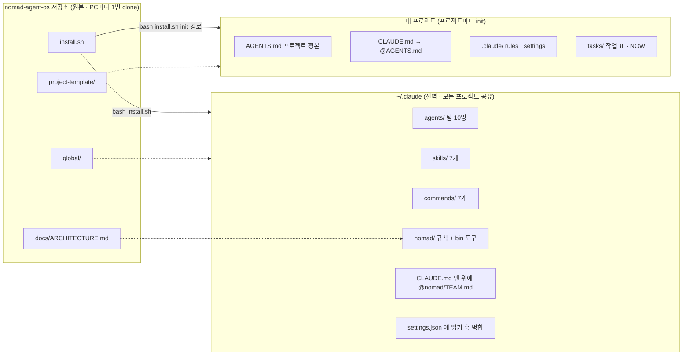
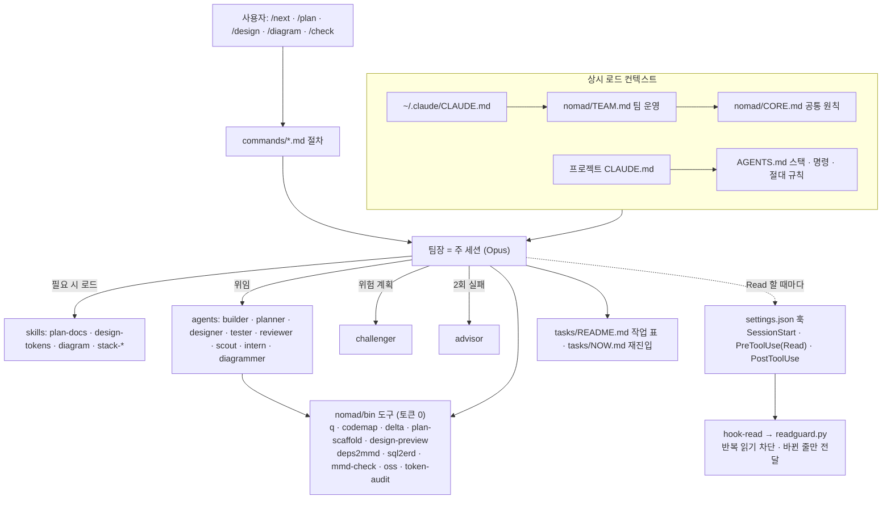

# NOMAD Agent OS

토큰을 아끼고 코딩·기획·디자인·다이어그램을 팀으로 처리하는 **Claude Code 멀티에이전트 최종 구조**.
4개 레포(platform-docs · tablet-kiosk-core · MultiAgent-Service-Fullstack-Tree-Framwork · Java-Service-Tree-Framework-Multi-Agent-Workspace)를 분석해 장점만 합쳤습니다.
설계 근거와 측정은 [`docs/ARCHITECTURE.md`](docs/ARCHITECTURE.md).

| | 기존 M | 기존 J | 기존 kiosk | **NOMAD Agent OS** |
|---|---|---|---|---|
| 상시 로드(추정 토큰) | 7,551 | 12,678 | 5,490 | **3,254** |
| 반복 읽기 차단 | ✗ | ✗ | ✗ | **훅으로 강제 + delta** |
| 그림·미리보기 생성 | 모델 | 모델 | 모델 | **스크립트(토큰 0)** |
| 오픈소스 도구·로컬 LLM | ✗ | ✗ | ✗ | **AGENTS.md 정본 + oss** |

## 설치 (macOS · Linux · Windows는 Git Bash)

**필요:** [Claude Code](https://claude.com/claude-code), git, Python 3.8+, (다이어그램 렌더링 시) Node.js — `npx`로 mermaid-cli 자동 사용.
Windows는 python.org 설치본을 쓰고, *설정 > 앱 > 앱 실행 별칭*에서 `python.exe`·`python3.exe` 스텁을 끄세요.

**1. 받기**
```bash
git clone https://github.com/DevOps0906/nomad-agent-os.git
cd nomad-agent-os
```

**2. 전역 설치** — 모든 프로젝트에서 같은 팀을 씁니다.
```bash
bash install.sh                 # ~/.claude: 팀 10명 · 스킬 7 · 명령 7 · 도구 12 · 훅
# 옵션: --no-path (PATH 등록 안 함), --codex (Codex CLI 전역 AGENTS.md에도 규칙 추가)
```
기존 `~/.claude/CLAUDE.md`·`settings.json`은 덮어쓰지 않고 한 줄 import·훅만 추가합니다. 같은 이름의 에이전트·스킬·명령은 백업 후 교체합니다(백업: `~/.claude/.nomad-backup/<시각>/`).
`~/.claude/nomad/bin`이 `~/.bashrc`(zsh면 `~/.zshrc`)의 PATH에 추가되니 **새 터미널**을 여세요.

> 1~2단계는 **PC마다 한 번**입니다. 새 프로젝트를 할 때마다 이 저장소를 다시 받지 않습니다.

**3. 프로젝트 적용** — 프로젝트마다 한 번. 어느 폴더에서 실행해도 됩니다.
```bash
bash ~/work/nomad-agent-os/install.sh init ~/work/내프로젝트                 # AGENTS.md 제목 = 폴더명
bash ~/work/nomad-agent-os/install.sh init ~/work/내프로젝트 --name "표시 이름"  # 제목 직접 지정
```
AGENTS.md · CLAUDE.md · rules · tasks를 복사합니다. 기존 파일은 보존·병합하고, `.git`과 원격 연결은 건드리지 않습니다(git 명령을 실행하지 않음).
그다음 `AGENTS.md`의 스택·명령·고유 규칙을 채우고, 프로젝트 폴더에서 `claude` 실행 → `/plan` 또는 `/next`.

- **이미 GitHub 저장소가 있으면:** 먼저 `git clone` → 그 폴더에 `init` → 추가된 파일을 커밋. (순서를 바꾸면 clone이 "폴더가 비어 있지 않음"으로 실패)
- **이 저장소 안의 경로는 거부됩니다.** 원본에 프로젝트 파일이 섞이지 않도록, 프로젝트는 항상 이 저장소 밖에 둡니다.

**4. 확인**
```bash
token-audit ~/work/내프로젝트    # 상시 로드 토큰 측정 (PATH 미등록 시 ~/.claude/nomad/bin/token-audit)
```
Claude Code에서 `/agents`를 열어 팀 10명이 보이면 끝입니다.

**업데이트:** 받은 폴더에서 `git pull && bash install.sh` — 다시 실행해도 훅·import는 중복 추가되지 않습니다.

| 언제 | 할 일 |
|---|---|
| PC마다 한 번 | 이 저장소 clone → `bash install.sh` (전역 설치) |
| 프로젝트마다 | `install.sh init <프로젝트 경로> [--name 이름]` 한 줄 |
| NOMAD 업데이트 시 | 이 저장소에서 `git pull && bash install.sh` |

> 팀(에이전트)·스킬·도구는 `~/.claude`에 있어 모든 프로젝트가 같이 씁니다. 프로젝트에는 그 프로젝트 전용 규칙 파일만 들어갑니다.

## 시작하기 — 두 가지 방식

### A. 이미 GitHub 저장소(코드)가 있을 때
```bash
cd ~/work
git clone https://github.com/<계정>/<저장소>.git                  # 1) 먼저 clone
bash ~/work/nomad-agent-os/install.sh init ~/work/<저장소>       # 2) 그 폴더에 init
cd <저장소> && claude
```
1. **`AGENTS.md`를 실제 코드에 맞추기 (가장 중요)** — 템플릿의 스택·명령(`pnpm dev` 등)은 예시입니다. `/check`·`/next`가 이 명령 표를 그대로 실행하므로 Claude에게 *"이 저장소를 분석해서 AGENTS.md의 스택·명령 표를 실제에 맞게 채워줘"*라고 맡깁니다.
2. **현재 구조 파악** — `/diagram 코드 구조도`(import 분석 → `docs/diagrams/architecture.mmd`), DB가 있으면 `/diagram erd`, `/check`로 린트·테스트가 도는지 확인.
3. **작업 표 만들기** — `/next`는 `tasks/README.md`를 따라 움직입니다(템플릿의 `task-001`은 예시). 새 기능이면 `/plan 기능명`, 작은 수정이면 *"tasks/README.md에 작업 등록해줘: ①… ②…"*.
4. **개발 반복** — `/next` → `/clear` → `/next` …
5. **커밋** — `git add -A && git commit -m "Add NOMAD agent config" && git push`

### B. 아무것도 없이 기획부터 시작할 때
```bash
bash ~/work/nomad-agent-os/install.sh init ~/work/<프로젝트> --name "<제품명>"   # 폴더가 없으면 생성
cd ~/work/<프로젝트> && git init -b main && claude
```
1. **기획** — `/plan <제품명>`: `docs/`에 문서 뼈대 8개(00_LEAN · 01_PRD · 02_ARCHITECTURE · 03_SCREENS_UX · 04_API · 05_DATA_MODEL · adr · diagrams) 생성.
   **00_LEAN(린 검증)부터** 진행하며, 통과 전에는 개발 작업을 만들지 않습니다. 제품 방향 질문만 사용자에게 묻고, 섹션은 planner들이 병렬로 채운 뒤 reviewer가 점검합니다. 마지막에 `tasks/task-NNN.md`가 자동 생성됩니다.
2. **그림 (선택)** — `/diagram 회원가입 흐름` · `/diagram 결제 시퀀스`
3. **디자인** — `/design`: 브리프(대상 · 주된 일 · 분위기 3단어 · 피할 것) → 시작 `tokens.css`(반응형 3구간 폰트) → **미리보기 HTML 자동 생성**. 브라우저로 보고 *"주색 더 진하게"*처럼 요청하면 토큰만 수정됩니다. **확정 전에는 화면 구현을 시작하지 않습니다.**
4. **`AGENTS.md` 확정** — *"기획 문서 기준으로 AGENTS.md 채워줘"*
5. **개발 반복** — `/next` → `/clear` → `/next` … (작업마다 자동 커밋)
6. **GitHub 연결** — `gh repo create <계정>/<프로젝트> --private --source . --push`

| 단계 | A. 저장소 있음 | B. 처음부터 |
|---|---|---|
| 준비 | clone → init | init → `git init` |
| 첫 작업 | `AGENTS.md`를 실제 코드에 맞춤 | `/plan`으로 기획 |
| 파악·설계 | `/diagram` · `/check` | `/diagram` · `/design` |
| 작업 목록 | `/plan 기능명` 또는 직접 등록 | `/plan`이 자동 생성 |
| 개발 | `/next` 반복 | `/next` 반복 |

> `install.sh init`은 `git init`과 다릅니다. git 명령을 실행하지 않으므로 clone한 저장소의 `.git`·원격 연결·커밋 기록은 그대로입니다. `git init`은 B처럼 **빈 새 폴더**에서만 씁니다.
> 쉬었다가 다시 시작할 때는 `/next`만 입력하면 `tasks/NOW.md`에서 이어갑니다. 같은 문제가 2번 실패하면 advisor가 자동 투입됩니다.

## 예시: SceneFlow — 기획·설계 문서가 이미 있는 저장소

[SceneFlow](https://github.com/DevOps0906/SceneFlow)는 **코드 없이 기획·설계 문서만 있는** 저장소입니다. 이 경우 A 방식(이미 저장소가 있을 때)을 쓰되, 기획을 새로 하지 않고 **있는 문서를 NOMAD가 읽는 자리에 연결**하는 것이 핵심입니다. 아래를 위에서부터 그대로 진행하면 됩니다.

### 0. 먼저 알아 둘 것

**우선순위 원칙 — 멀티에이전트 운영은 NOMAD가 우선합니다.**

| 무엇에 대한 것인가 | 우선 | 예 |
|---|---|---|
| **어떻게 일하나** — 팀 구성 · 위임 · 검증 강도 · 모델 · 작업 파일 형식 · 재진입 · 커밋 흐름 | **NOMAD** (`~/.claude/nomad/TEAM.md` · `CORE.md` · `commands/` · `agents/`) | 06장의 권장 모델(Fable/Opus/…), 안내서의 `claude-main` · `plan-challenger` · `review-expert` 같은 에이전트 이름, `task.md`·`context.md`·`log.md` 3파일 폴더, `gate.sh` 승인 게이트, "main worker는 …" 요청 프롬프트 → **참고만 하고 NOMAD 방식으로 실행** |
| **무엇을 만드나** — 요구사항 · 설계 · 데이터 · API · 화면 · 수용 기준 · 소유 경계 · 절대 규칙 · 착수 전 결정 | **SceneFlow 문서** (`docs/file/`) | PRD, 05_DATA_MODEL, 04-구현/CLAUDE.md 2절 절대 규칙, 06장의 작업 목록 · 웨이브 · 선행 · 수용 기준 → **그대로 따름** |

두 쪽이 부딪히면 위 표로 판정하고, 판정이 애매하면 팀장이 사용자에게 묻습니다. 이 원칙은 2단계에서 `AGENTS.md` 6장에 적어 두어 모든 세션이 따르게 합니다.

**겹치는 에이전트 · 스킬 · 도구 → NOMAD 쪽을 씁니다.** SceneFlow 안내서(9.2 · 9.4 · 10절)에 나오는 이름이 보이면 오른쪽으로 바꿔 읽습니다.

| SceneFlow 안내서 (platform 베이스) | NOMAD에서 대신 쓰는 것 |
|---|---|
| `claude-main` (오케스트레이터, Opus) | **팀장 = 주 세션** (`/next`가 계획 · 위임 · 검증 진행) |
| `plan-challenger` (착수 전 계획 공격) | **challenger** — 위험도 `높음`이면 자동 |
| `claude-reviewer` · `review-expert` | **reviewer** (mode = code · contract · security · doc) |
| `nextjs-expert` · `fastapi-expert` · `supabase-expert` | **builder** + 스킬 `stack-nextjs` · `stack-fastapi` · `stack-supabase` (영역 규칙이 자동 지정) |
| `frontend-design` · `ui-ux-pro-max` 스킬 | **designer** + `design-tokens` 스킬 (`/design`) |
| `deliverable-first` 스킬 · `_index.md` 추출 | `docs/file/_index.md`는 이미 완성본 → **scout**로 필요한 산출물만 찾기 |
| Haiku 작업 ("오케스트레이터가 직접 처리") | **intern** |
| 고문 Fable | **advisor** — 같은 문제 2회 실패 시만 |
| `tasks/<ID>/task.md · context.md · log.md` | `tasks/README.md` 작업 표 + `tasks/VID-06-###.md` 1파일 + `tasks/NOW.md` |
| `workers_approved` · `gate.sh` · `scope_check.sh` | 작업 파일의 **쓰기 허용** 행 + 위험도별 검증 (사용자 확인이 필요한 결정만 묻기) |
| `log.md`의 `[DECISION]` · `[APPROVAL]` | `tasks/NOW.md` "열린 결정" + 커밋 본문 |
| `reentry-check.sh` (재진입 점검) | `tasks/NOW.md` + `delta --changed` (`/next`가 자동) |
| `/agent-check` · `check-invariants.sh` | `/check` (AGENTS.md 명령 표 실행) |
| `llm-wiki` 스킬 (개발 위키 `docs/wiki/`) | NOMAD에 대응 없음 → **`docs/wiki/`는 문서로 유지**, 갱신이 필요하면 작업으로 등록해 planner에게 |

> ⚠️ **프로젝트에 같은 이름의 에이전트를 만들지 않습니다.** Claude Code는 프로젝트 `.claude/agents/`의 에이전트를 같은 이름의 전역(`~/.claude/agents/`) 에이전트보다 우선합니다. SceneFlow에 `builder.md` · `reviewer.md` 같은 파일이 생기면 NOMAD 팀원이 조용히 바뀌므로, 생겼다면 지우거나 다른 이름으로 바꿉니다. 확인: `ls .claude/agents 2>/dev/null` (아무것도 없어야 정상).

| SceneFlow에 이미 있는 것 | 위치 | NOMAD에서 쓰는 법 |
|---|---|---|
| 산출물 25개 (PRD · 아키텍처 · 화면 · API · 데이터 · 공용코어 · 디자인) | `docs/file/` (등록부 `_index.md`) | **정본 그대로 사용.** `AGENTS.md` 문서 지도에 경로만 연결 |
| 작업 114개 · 웨이브 W0~W8 · 소유 경계 · 수용 기준 | `docs/file/01-관리/06_AGENT_PLAN.md` | 웨이브 단위로 `tasks/`에 옮겨 `/next`로 실행 |
| 개발지침 (절대 규칙 · 디렉토리 소유 · 코드 규칙 · 완료 조건) | `docs/file/04-구현/CLAUDE.md` (181줄) | 핵심만 `AGENTS.md`에 요약, 상세는 작업 영역 절만 읽기 |
| 착수 전 결정 D-1 ~ D-29 | `docs/file/02-요구사항/01_PRD.md` 8절 | 해당 작업 직전에 확정 (`tasks/NOW.md` 열린 결정) |
| 대시보드 시안 · 디자인 시스템 기준 | `design/dashboard-canvas/` · `docs/file/03-설계/디자인/` | `/design`의 근거로 사용 |

> ⚠️ **둘 중 하나만 쓰세요.** SceneFlow 개발 안내서(`docs/guide/sceneflow_develop.md`)는 platform 베이스를 복사하는 `setup-sceneflow.sh`로 **별도의 에이전트 체계**(`claude-main` · `plan-challenger` · `_shared/` · `gate.sh` …)를 설치합니다. NOMAD를 쓴다면 이 setup 스크립트는 **실행하지 않습니다.** 두 체계를 같이 깔면 루트 `CLAUDE.md`와 에이전트가 겹쳐 지시가 충돌합니다. 안내서의 3~5장(베이스 복사 · project-profile) 대신 아래 1~4단계를, 9~10장(task 변환 · 웨이브 사이클) 대신 5~7단계를 씁니다. 그 밖의 장(결정 · AI 계층 · 디자인 · 인증 단계 · 위험)은 그대로 유효합니다.
>
> ⚠️ **`/plan`으로 기획을 다시 만들지 않습니다.** `plan-scaffold`가 `docs/00_LEAN.md` 등을 새로 만들어 기존 `docs/file/`과 중복됩니다. `/plan`은 나중에 *새 기능*을 추가할 때만, "기존 `docs/file/` 체계에 추가해줘"라고 지시해서 씁니다.

### 1. 받기 + NOMAD 적용 (Git Bash)
```bash
bash /d/WorkSpace/DEV/nomad-agent-os/install.sh            # PC에서 처음이면 1번만 (이미 했으면 생략)

cd /d/WorkSpace/DEV
git clone https://github.com/DevOps0906/SceneFlow.git
bash /d/WorkSpace/DEV/nomad-agent-os/install.sh init /d/WorkSpace/DEV/SceneFlow --name SceneFlow

cd SceneFlow
git status --short        # 새로 생긴 것: AGENTS.md CLAUDE.md .claude/ .gemini/ .gitignore tasks/  (기존 파일 변경 없음)
claude
```

### 2. `AGENTS.md` 채우기 — 모든 AI 도구가 매번 읽는 1장 (80줄 이내)
Claude에게 그대로 요청합니다.
```text
docs/file/04-구현/CLAUDE.md, docs/file/03-설계/02_ARCHITECTURE.md 1~2절, docs/file/_index.md 를 근거로
AGENTS.md 를 SceneFlow에 맞게 채워줘. 80줄 이내로, 아래 원칙을 지켜줘.
- 1장: 한 문장 설명 + 정본은 docs/file/, 상세 개발지침은 docs/file/04-구현/CLAUDE.md (작업 영역 절만 읽기)
- 2장 스택: apps/sceneflow(Next.js 16·React 19·Tailwind CSS v4) · supabase/ · workers/video-orchestrator(BullMQ)
  · services/media-worker(Python 3.11) · apps/api(FastAPI 3.12·LangGraph) · packages/sns-uploader
- 3장 명령: 04-구현/CLAUDE.md 6절 표를 그대로 (아직 코드가 없으니 "W1 이후 확정" 표시)
- 4장 절대 규칙: 04-구현/CLAUDE.md 2절에서 위반 시 사고가 나는 것만 8개 이내 (service_role · 크레딧 선차감 · 스키마 소유 · LLM 키 위치 · AI 경계 · 대가성 문구 · Tailwind v4 · 토큰 정답)
- 5장 문서 지도: docs/file/ 산출물 경로 표 (템플릿의 docs/01_PRD.md 같은 경로는 실제 경로로 교체)
- 6장 작업 방식: 작업 ID는 VID-06-###, 커밋은 "[VID-06-###] 요약", 쓰기 허용 경로 밖은 수정하지 않고 요청 작업을 남김,
  구현이 산출물과 다르면 코드를 맞추지 말고 산출물 갱신 작업을 따로 만듦
- 6장 맨 위에 우선순위 원칙: "멀티에이전트 운영(팀 구성·위임·검증·모델·작업 형식)은 NOMAD(~/.claude/nomad/TEAM.md)가 우선한다.
  docs/의 권장 모델·에이전트 이름(claude-main 등)·task 폴더 형식·gate.sh는 참고만 한다.
  요구사항·설계·수용 기준·소유 경계·절대 규칙은 docs/file/이 정본이다."
```
완성되면 첫 부분이 이런 모양이 됩니다.
```markdown
# AGENTS.md — SceneFlow
## 1. 무엇인가
말로 지시하면 AI가 편집안을 만들고 승인하면 실행하는 AI 자동편집 영상 SaaS. 정본: `docs/file/`(등록부 `_index.md`).
상세 개발지침: `docs/file/04-구현/CLAUDE.md` — 작업 영역의 절만 읽는다.
## 2. 스택
| 영역 | 선택 | 위치 |
|---|---|---|
| 웹 | Next.js 16 · React 19 · TS strict · Tailwind CSS v4 · shadcn/ui · zod · TanStack Query | `apps/sceneflow` |
| DB | Supabase (Postgres · pgvector · RLS) | `supabase/` |
| 오케스트레이터 | Node 20 · BullMQ FlowProducer | `workers/video-orchestrator` |
| 미디어 워커 | Python 3.11 · Whisper · demucs · FFmpeg | `services/media-worker` |
| AI 서비스 | FastAPI · Python 3.12 · LangGraph (LLM 키는 여기에만) | `apps/api` |
...
```

### 3. 영역 규칙 경로를 SceneFlow 구조에 맞추기
템플릿 규칙은 `apps/web/**` 기준이라 그대로 두면 **로드되지 않습니다.** Claude에게 요청합니다.
```text
.claude/rules/ 를 SceneFlow 디렉토리에 맞게 고쳐줘.
- web.md: paths 를 apps/sceneflow/** 로. "UI 작업이면 docs/file/03-설계/디자인/DESIGN_SYSTEM.md 먼저, 토큰 정답은
  apps/sceneflow/src/styles/tokens.css, 화면 작업은 VID-06-044 완료 뒤" 추가
- api.md: docs/04_API.md → docs/file/03-설계/04_API.md. "FastAPI는 영상·오디오 바이너리를 처리하지 않는다" 추가
- db.md: "video 스키마 변경은 VID-06-001(이후 066, 085)만", ERD 명령에 --match 로 영역 분할 추가
- docs.md: docs/file/ 은 DOC_TEMPLATE 체계를 따르고, 산출물 상태를 바꾸면 _index.md 변경 이력에 기록
- workers.md 새로 만들기: paths workers/** · services/media-worker/** · packages/sns-uploader/**,
  "미디어 워커와 FastAPI는 서로 호출하지 않는다, 미디어 워커는 LLM·ElevenLabs 키를 갖지 않는다, 하위 프로세스는 인자 배열·타임아웃·kill"
```

### 4. 첫 커밋
```bash
git add -A && git commit -m "Add NOMAD agent config (AGENTS.md, rules, tasks)" && git push
```

### 5. 모델 배정 옮기기 — 06_AGENT_PLAN의 "권장 모델" → NOMAD 위험도
SceneFlow 계획서는 작업마다 권장 모델을 적어 두었습니다. NOMAD에서는 이것을 **위험도**로 바꾸면 검증 강도가 자동으로 맞춰집니다(전역 `TEAM.md` 위험도별 검증 표).

| 06장 권장 모델 | 작업 성격 | NOMAD 위험도 | 담당 | 자동으로 붙는 검증 |
|---|---|---|---|---|
| Fable | 결제 · 권한 · RLS · 데이터 모델 · 오케스트레이터 · AI 보안 | **높음** | builder | 착수 전 **challenger** → 변경 후 reviewer(code + security/contract) → 필요 시 tester |
| Opus | 기능 구현 · API 연동 · 워커 · 그래프 · 테스트 설계 | **보통** | builder (테스트 작업은 tester) | reviewer(code) |
| Sonnet | UI · 컴포넌트 · 3D 히어로 · 문서 | **낮음** (화면은 보통) | builder · designer · planner(문서) | builder 자가 검증 |
| Haiku | 보일러플레이트 · 린트 · 문구 · 반복 체크 | 낮음 | intern | — |
| 사람 | VID-06-043 디자인 검토 · G1/G2 게이트 · 원본 삭제 승인 | — | **사용자** (상태 `보류`) | 사용자가 판정 후 `완료` |

같은 문제로 2번 실패하면 advisor(Fable)가 자동 투입되므로 "Fable 작업"을 따로 Fable로 돌릴 필요는 없습니다.

### 6. 작업을 웨이브 단위로 `tasks/`에 옮기기
114개를 한 번에 옮기지 않습니다. **지금 시작할 웨이브만** 옮기고, 끝나면 다음 웨이브를 옮깁니다.
```text
docs/file/01-관리/06_AGENT_PLAN.md 2절(작업 목록)과 3절(웨이브)에서 W0 작업(VID-06-001, 040, 041)만
tasks/ 로 옮겨줘.
- tasks/README.md 작업 표: 번호=VID-06-###, 웨이브, 선행, 위험도(권장 모델 → 위 표 기준), 담당, 상태=대기. 템플릿 예시 행 task-001은 삭제
- 작업마다 tasks/VID-06-###.md (plan-docs 의 task 템플릿):
  근거 = 06_AGENT_PLAN.md 해당 행 + 그 행의 "출처" 문서#절, 쓰기 허용 = "소유 파일/디렉토리" 열,
  완료 조건 = "수용 기준" 열을 실행 가능한 확인으로, 하지 않을 것 = 다른 작업 소유 경로·원격 db push
- 이 웨이브에 걸린 착수 전 결정(01_PRD.md 8절, 예: VID-06-001 전 D-1, VID-06-041 전 D-19)을 tasks/NOW.md "열린 결정"에 적어줘
```
결과 예시 (`tasks/README.md`):
```markdown
| 번호 | 제목 | 웨이브 | 선행 | 위험도 | 담당 | 상태 |
|---|---|---|---|---|---|---|
| VID-06-001 | 1200 조각 적용 · 모놀리스 변환 · 타입 생성 | W0 | — | 높음 | builder | 대기 |
| VID-06-040 | 원본 정리 (git 태그 · 삭제는 사용자 승인 후) | W0 | — | 보통 | builder | 대기 |
| VID-06-041 | 디자인 레퍼런스 (디자인 시스템 1단계) | W0 | — | 낮음 | designer | 대기 |
```
결과 예시 (`tasks/VID-06-001.md`의 머리):
```markdown
| 항목 | 내용 |
|---|---|
| 웨이브 | W0 |
| 위험도 | 높음 (06장 권장 Fable: 데이터 모델) |
| 근거 | `docs/file/01-관리/06_AGENT_PLAN.md#2` VID-06-001 행 · `docs/file/03-설계/05_DATA_MODEL.md` · `docs/file/03-설계/공용코어/DB_CONVENTIONS.md` |
| 쓰기 허용 | `supabase/migrations/1200_video.sql` · `supabase/monolith/**` · `scripts/mono-convert.mjs` · `apps/sceneflow/src/types/supabase.ts` |
## 완료 조건
- [ ] `supabase db reset` 오류 0
- [ ] 타입 파일에 26개 테이블, AI 라우팅 17행 · 체인 검사 DO 블록 통과
```

### 7. 개발 반복 — 웨이브 사이클
```text
① 결정 확인   tasks/NOW.md 의 열린 결정을 사용자가 확정 (예: "D-1은 권고안대로 public 스키마")
② /next VID-06-001   → 팀장 계획 5줄 → 위험도 높음이라 challenger 먼저 → builder 구현 → reviewer(code+security) → 완료 조건 실행 → 커밋 [VID-06-001]
③ /clear → /next     → 다음 대기 작업 (tasks/NOW.md 에서 이어감)
④ 웨이브의 작업이 모두 완료 → 6단계 요청을 "W1 작업만"으로 바꿔 다시 실행 → ② 반복
```
| 웨이브 | 이때 쓰면 좋은 명령 |
|---|---|
| W0 (DB 적용) | 끝나면 ERD: `/diagram erd` → 77개 테이블이라 영역별 분할 — `sql2erd supabase/migrations -o docs/diagrams/erd-ai.mmd --match '^ai_'` (그 밖에 `^(storyboard\|longform\|edit)_`, `^(affiliate\|linkinbio)_` 등) |
| W1 (앱 · 워커 · AI 골격) | 골격이 생기면 `AGENTS.md` 3장 명령을 실제 값으로 확정 → `/check`로 확인 |
| W1-D (디자인 036 → 042 → **043 사람** → 044) | `/design` + "근거는 docs/file/03-설계/디자인/DESIGN_SYSTEM.md 와 design/dashboard-canvas/ 시안, 토큰 파일은 apps/sceneflow/src/styles/tokens.css" → 미리보기를 **직접 보고 확정**해야 화면 작업(W3~) 시작 |
| W2 ~ W6 | `/next` 반복. 웨이브 끝마다 `/diagram 코드 구조도`로 실제 구조 확인 |
| W7 (G1 → 063) · W8 (G2 → 064 · 065) | G1 · G2는 사람이 판정 (`docs/guide/sceneflow_develop.md` 19.3 · 19.5 체크리스트) → `tasks/NOW.md`에 "G1 통과" 기록 후 `/next` |

### 8. 진행 체크리스트
- [ ] `setup-sceneflow.sh`를 실행하지 않았다 (NOMAD와 이중 설치 방지)
- [ ] `AGENTS.md` 6장에 우선순위 원칙(운영은 NOMAD, 내용은 `docs/file/`)이 적혀 있다
- [ ] 프로젝트 `.claude/agents/`가 비어 있다 (NOMAD 팀원을 덮어쓰는 같은 이름 에이전트 없음)
- [ ] `AGENTS.md`가 80줄 이내이고, 문서 지도가 `docs/file/` 실제 경로를 가리킨다
- [ ] `.claude/rules/web.md` paths가 `apps/sceneflow/**`이고, `workers.md`가 있다
- [ ] `tasks/README.md`에는 **현재 웨이브만** 있고, 예시 행 `task-001`은 지웠다
- [ ] 각 작업의 착수 전 결정(D-#)을 그 작업 직전에 확정했다
- [ ] 사람 작업(VID-06-043, G1, G2, VID-06-040의 삭제)은 `보류`로 두고 직접 판정했다
- [ ] 구현이 산출물과 달라지면 산출물 갱신 작업을 만들고, `_index.md` 상태 · 변경 이력을 고쳤다

## 매일 쓰는 법

| 하고 싶은 일 | 명령 |
|---|---|
| 다음 작업 하나를 팀으로 끝내기 | `/next` (끝나면 `/clear` 후 다시 `/next`) |
| 기획 (린 검증 → PRD → 명세 → 작업 분해) | `/plan 제품명` |
| 디자인 시스템 (토큰 → 3구간 폰트 → 미리보기) | `/design` |
| 구조도·흐름도·ERD | `/diagram erd` · `/diagram 결제 흐름` |
| 린트·타입·테스트 실패만 요약 | `/check` |
| 상시 로드 토큰 점검 | `/token-audit` |
| 단순 작업을 로컬 LLM에 | `/oss 이 로그 3줄 요약` |

## 팀

| 직급 | 에이전트 | 모델 |
|---|---|---|
| 고문 | advisor (2회 실패 시만) | Fable 5.1 |
| 팀장 | 주 세션 | Opus 5.5 |
| 검증 | challenger (위험 계획) | Opus 5.5 |
| 대리 | builder · planner · designer · tester · reviewer | Sonnet 5.5 |
| 사원 | scout · intern · diagrammer | Haiku 5.5 |

## 도구 (`~/.claude/nomad/bin`)

| 도구 | 하는 일 |
|---|---|
| `q <명령>` | 긴 출력 명령을 실행하고 실패 줄 + 꼬리만 표시, 전체 로그는 `.nomad/logs/` |
| `codemap [폴더] [--tree]` | 파일·export·함수 시그니처 지도 (통독 대신) |
| `delta <파일>` · `delta --changed` · `delta --checkpoint` | 바뀐 줄만(다른 AI 도구용) / 체크포인트 이후 바뀐 파일만 / 체크포인트 저장 |
| `plan-scaffold [docs] --name 제품명` | 기획 문서 8개 뼈대 |
| `design-preview tokens.css -o design/preview.html --md docs/DESIGN_TOKENS.md` · `--init` | 토큰 미리보기 HTML·표 자동 생성 |
| `deps2mmd <소스> -o docs/diagrams/architecture.mmd` | import 분석 구조도 |
| `sql2erd supabase/migrations -o docs/diagrams/erd.mmd [--match ^video_]` | SQL → ERD |
| `mmd-check <파일.mmd>` | Mermaid 검증 + SVG 렌더링 |
| `oss "<지시>" <파일> -o 결과.md` | Ollama 등 로컬 LLM에 위임 |
| `token-audit [프로젝트]` | 상시 로드 토큰 측정·경고 |
| `readguard` · `hook-read` | 반복 읽기 차단 훅 (자동) — 바뀐 파일은 바뀐 줄만 전달, 같은 요청 두 번째는 허용 |

## 구조

### 설치 구조 — 어디에서 어디로 복사되나


### 실행 구조 — Claude Code 세션에서 무엇이 무엇을 부르나


### 파일 트리
```text
nomad-agent-os/
├── README.md                     # 이 문서: 설치 · 시작 방법 · 명령 · 구조
├── install.sh                    # 설치기. 인자 없으면 전역(~/.claude) 설치, `init <경로> [--name]`이면 프로젝트 적용
├── .gitattributes                # 줄바꿈을 LF로 고정 (Windows에서 받아도 스크립트가 깨지지 않게)
├── docs/
│   └── ARCHITECTURE.md           # 설계서: 4개 레포 분석, 설계 원칙, 토큰 최적화 장치, 로드맵
│
├── global/                       # ▶ 전역 설치 원본 → ~/.claude 로 복사
│   ├── CLAUDE.md                 # 전역 CLAUDE.md 기본본 (@nomad/TEAM.md import + 개인 설정 자리). 기존 파일이 있으면 import 한 줄만 추가
│   ├── settings.nomad.json       # settings.json 에 병합할 훅 3개 (SessionStart · PreToolUse(Read) · PostToolUse → hook-read)
│   ├── agents/                   # 팀원(서브에이전트) 정의 — 직급별 모델 지정
│   │   ├── advisor.md            #   고문: 같은 문제로 2회 이상 실패했을 때만 근본 원인 진단
│   │   ├── challenger.md         #   검증: 결제 · 인증 · RLS · 마이그레이션 등 위험 계획을 착수 전 공격 (읽기 전용)
│   │   ├── builder.md            #   대리: 코드 구현 · 수정 · 리팩터링 (stack-* 스킬 먼저 읽음)
│   │   ├── planner.md            #   대리: PRD · 명세 · ADR · 작업 분해 문서의 지정 섹션 작성
│   │   ├── designer.md           #   대리: 디자인 토큰 · DESIGN.md · 컴포넌트 명세 (반응형 3구간)
│   │   ├── tester.md             #   대리: 테스트 작성 · 실행 (운영 코드는 수정 안 함)
│   │   ├── reviewer.md           #   대리: 적대적 리뷰 mode=code · contract · security · doc (읽기 전용)
│   │   ├── scout.md              #   사원: 파일 · 코드 위치 탐색, 구조 요약 (읽기 전용)
│   │   ├── intern.md             #   사원: 값 추출 · 형식 변환 · 일괄 이름 변경 같은 기계적 작업
│   │   └── diagrammer.md         #   사원: Mermaid(.mmd) 구조도 · 흐름도 · ERD 작성 + mmd-check 검증
│   ├── commands/                 # 슬래시 명령 — 사용자가 직접 부르는 절차
│   │   ├── next.md               #   /next: 다음 작업 하나를 계획 → 위임 → 검증 → 커밋까지
│   │   ├── plan.md               #   /plan: 린 검증 → PRD → 명세 → 작업 분해 (섹션 병렬 작성)
│   │   ├── design.md             #   /design: 토큰 중심 디자인 시스템 + 미리보기
│   │   ├── diagram.md            #   /diagram: 구조도 · 흐름도 · 시퀀스 · ERD 생성 · 검증
│   │   ├── check.md              #   /check: 린트 · 타입 · 테스트 실행, 실패만 요약
│   │   ├── token-audit.md        #   /token-audit: 상시 로드 토큰 측정 + 줄일 곳 제안
│   │   └── oss.md                #   /oss: 단순 텍스트 작업을 로컬 LLM(Ollama 등)에 위임
│   ├── skills/                   # 스킬 — 필요할 때만 로드되는 절차 · 규약
│   │   ├── plan-docs/            #   기획 문서 절차
│   │   │   ├── SKILL.md          #     절차 본문
│   │   │   └── templates/        #     lean.md(린 검증) · prd.md · adr.md(결정 기록) · task.md(작업 1건)
│   │   ├── design-tokens/SKILL.md#   브리프 → 토큰 → 3구간 폰트 → 미리보기 → 사람 확정
│   │   ├── diagram/SKILL.md      #   Mermaid 작성 규칙 (ERD는 sql2erd 기계 생성)
│   │   ├── stack-nextjs/         #   Next.js · React · Tailwind v4 · shadcn/ui 규약
│   │   ├── stack-supabase/       #   Postgres · RLS · Auth · 마이그레이션 규약
│   │   ├── stack-fastapi/        #   FastAPI · Pydantic v2 · LLM 게이트 규약
│   │   │   ├── SKILL.md          #     (stack-* 공통) 요약 + 언제 읽나
│   │   │   └── references/       #     build-and-run.md(명령) · conventions.md(규약) · pitfalls.md(리뷰 체크리스트)
│   │   └── stack-flutter/        #   Flutter · Riverpod 3 · go_router · drift 규약 (SKILL.md + pitfalls.md)
│   └── nomad/                    # NOMAD 본체 → ~/.claude/nomad
│       ├── TEAM.md               #   팀 운영 규칙 (Claude Code 전용) — 직급 · 위임 · 검증 표. CORE.md import
│       ├── CORE.md               #   모든 AI 도구 공통 원칙 (Claude Code · Codex · OpenCode · Gemini CLI)
│       └── bin/                  #   도구 — 모델 대신 스크립트가 처리해 토큰 0 (PATH 등록)
│           ├── q                 #     긴 출력 명령 실행 → 실패 줄 + 꼬리 + 종료 코드만 표시
│           ├── codemap           #     파일 · export · 함수 시그니처 지도 (통독 대신)
│           ├── delta             #     마지막으로 본 뒤 바뀐 줄 / 바뀐 파일만 · 체크포인트 저장
│           ├── plan-scaffold     #     기획 문서 뼈대 8개 생성 (기존 파일 보존)
│           ├── mmd-check         #     Mermaid 문법 검증 + SVG/PNG 렌더링 (mermaid-cli)
│           ├── oss               #     OpenAI 호환 로컬 LLM에 텍스트 작업 위임
│           ├── hook-read         #     훅 → readguard 호출 래퍼 (의도적 차단 외 실패는 통과 처리)
│           ├── _py               #     파이썬 도구 공통 실행기 (Windows 파이썬 탐지 · UTF-8)
│           ├── deps2mmd · design-preview · readguard · sql2erd · token-audit   # _py 를 거쳐 py/ 실행
│           └── py/
│               ├── deps2mmd.py   #       import 분석 → 모듈 의존 구조도 (TS/JS · Python · Dart)
│               ├── design-preview.py #   tokens.css → 미리보기 HTML · 토큰 표 (--init 시작 토큰)
│               ├── readguard.py  #       반복 읽기 차단 훅 본체 · 바뀐 줄만 전달
│               ├── sql2erd.py    #       SQL 마이그레이션 → Mermaid ERD
│               └── token-audit.py#       상시 로드 컨텍스트 토큰 추정 · 예산 초과 경고
│
└── project-template/             # ▶ 프로젝트 템플릿 → init 대상 폴더로 복사 (기존 파일 보존 · 병합)
    ├── AGENTS.md                 # 프로젝트 단일 정본: 무엇인가 · 스택 · 명령 · 절대 규칙 · 문서 지도 (모든 AI 도구 공용)
    ├── CLAUDE.md                 # @AGENTS.md import + Claude Code 전용 메모
    ├── .gitignore                # .nomad/ · .env · node_modules/ 등 (없는 줄만 병합)
    ├── .claude/
    │   ├── settings.json         # 모델 지정 + 읽기 차단(.env · node_modules · lock 파일 · 빌드 산출물)
    │   └── rules/                # 경로 한정 규칙 — 해당 폴더 작업 때만 로드
    │       ├── web.md            #   apps/web/**
    │       ├── api.md            #   apps/api/**
    │       ├── db.md             #   supabase/**
    │       └── docs.md           #   docs/**
    ├── .gemini/settings.json     # Gemini CLI 가 AGENTS.md 를 컨텍스트로 읽게 설정
    └── tasks/
        ├── README.md             # 작업 표 (번호 · 웨이브 · 선행 · 위험도 · 담당 · 상태) + 발견한 문제 · 교훈
        └── NOW.md                # 재진입 스냅샷 30줄 — /next 가 매 작업 끝에 덮어씀
```

## 제거
`~/.claude/agents|skills|commands`의 NOMAD 파일과 `~/.claude/nomad/`를 지우고, `~/.claude/CLAUDE.md` 첫 줄 `@nomad/TEAM.md`와 `settings.json`의 `hook-read` 훅 3개를 삭제합니다.
