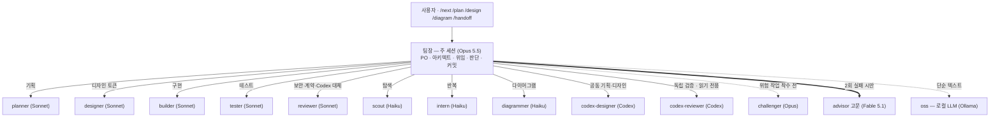
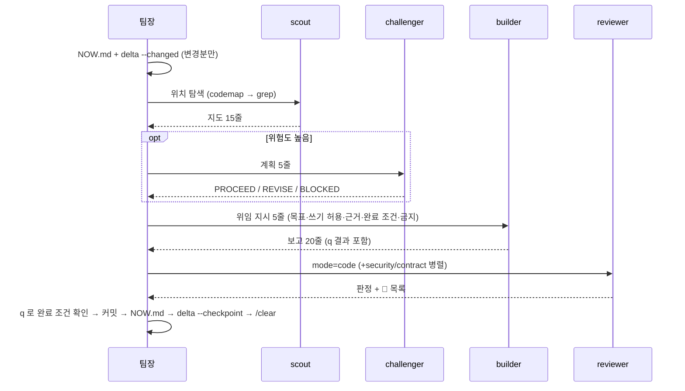
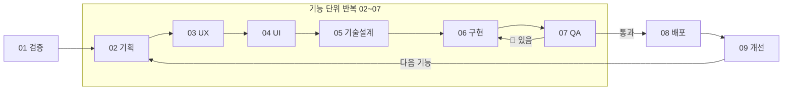

# NOMAD Agent OS — 최종 멀티에이전트 구조 설계서

> 작성 2026-10-27 · 대상 Claude Code (v2.1.271 이상 권장) · 호환 ChatGPT Codex · Gemini CLI · OpenCode · Ollama · 설치 Git Bash · PowerShell
> 분석 대상: `platform-docs`, `tablet-kiosk-core`, `MultiAgent-Service-Fullstack-Tree-Framwork`(이하 M), `Java-Service-Tree-Framework-Multi-Agent-Workspace`(이하 J)
> 이 문서는 필요할 때만 읽는다(상시 로드 아님).

---

## 1. 문제 — 4개 레포 분석 결과

### 1.1 측정 (상시 로드 = 세션 시작마다 모든 턴에 붙는 컨텍스트, `token-audit` 추정)

| 구조 | CLAUDE.md 계열 | 에이전트 설명 | 스킬·명령 설명 | **합계** | 작업당 필수 읽기 |
|---|---|---|---|---|---|
| M (풀스택 프레임워크) | 3,324 | 3,059 (10개) | 1,168 | **7,551** | 약 4,000 (routing·템플릿·log) + 재진입 2,324 |
| J (Java 워크스페이스) | 3,009 | 6,006 (16개) | 3,663 | **12,678** | M과 동일 + 도메인 스킬 본문 12~17KB |
| tablet-kiosk-core | 2,461 | 2,476 (11개) | 553 | **5,490** | task 문서 해당 장 |
| **NOMAD Agent OS (전역+프로젝트)** | 2,167 | 552 (10개) | 535 | **3,254** | NOW.md + `delta --changed` |

→ 상시 로드는 M 대비 **57% 감소**, J 대비 **74% 감소**. 작업당 의식(ceremony) 읽기는 사실상 0.

### 1.2 토큰을 녹이던 원인 (발견 순)

| # | 원인 | 어디서 | 영향 |
|---|---|---|---|
| 1 | 에이전트 description에 예시(`<example>`)·경계 설명을 길게 씀 | J·M·kiosk 전부 | 설명은 **매 턴** 로드됨. J는 설명만 9,600토큰 |
| 2 | 같은 이름의 에이전트와 스킬이 둘 다 긴 설명을 가짐 | J(ai·broker·config·engine·middleproxy), kiosk(3쌍) | 같은 정보 2배 로드 |
| 3 | 도메인 에이전트에 `model:` 미지정 | J 8개 | 주 세션 모델(Opus)을 그대로 상속 → 구현 비용 최고가 |
| 4 | 도구 화이트리스트 없음(`tools` 생략) | J·M 구현 에이전트 | 모든 도구 스키마(MCP 포함)를 하위 에이전트마다 로드 |
| 5 | 승인 게이트 의식: `workers_approved`·`[APPROVAL]` 로그·`gate.sh`·`scope_check.sh`·brief/result 폴더 | M·J | 작업마다 템플릿 4~5개 읽기·쓰기. learnings.md 10건 중 6건이 이 장치의 오탐·Windows 문제 |
| 6 | 영문 Karpathy 원칙 전문 + 한국어 운영 규칙 혼재 | M·J CLAUDE.md | 1,500토큰 상시 |
| 7 | 긴 명령 출력을 그대로 받음(테스트·빌드 로그) | 전부 | 한 번에 수천~수만 토큰 |
| 8 | 다이어그램·ERD·미리보기 HTML을 모델이 직접 생성 | platform-docs 작업 흐름 | 생성·수정 왕복마다 수천 토큰 |
| 9 | **이미 읽은 파일을 처음부터 다시 읽음** | 모든 세션 | 긴 문서 하나가 대화당 여러 번 통째로 들어감 |

### 1.3 살릴 것 (레포별 강점)

| 레포 | 가져온 것 |
|---|---|
| kiosk | 직급형 팀(고문·팀장·대리·사원), 위험도별 검증 배치, "경로만 넘긴다", 팀장만 커밋, `/next-task` 흐름 |
| M | Karpathy 4원칙(한국어 4줄로 압축), 산출물 근거 개발(근거 문서#장), 스택 스킬 references(conventions·pitfalls·build-and-run), 교훈 기록 |
| J | 읽기 전용 리뷰어의 **반박 패스**(Stands/Refuted), 계약 리뷰 관점, 설계 전용 에이전트 개념(→ planner) |
| platform-docs | 문서 체계(00_LEAN·01_PRD~06_AGENT_PLAN), 토큰 파일이 디자인 정답, Tailwind CSS v4 명시 규칙 |
| ultimate-guide(J reference) | `omitClaudeMd`, `skills:` 프리로드, 경로 조건 rules, 상시 로드 계측 개념 |

---

## 2. 전략 — 설계 원칙 7가지

1. **상시 로드 4,000토큰 예산**: 매 턴 붙는 것(CLAUDE.md·설명)은 판단에 꼭 필요한 것만. 나머지는 필요할 때 읽는 파일로.
2. **역할은 에이전트, 지식은 스킬, 강제는 훅**: 에이전트 12개는 직급·역할로만 나누고(설명 1문장), 스택 지식은 스킬 파일을 필요할 때 Read. 지켜야 하는 규칙은 문장이 아니라 훅·스크립트로 강제.
3. **싼 모델이 넓게, 비싼 모델은 좁게**: 탐색·반복·다이어그램은 Haiku, 구현·기획·디자인·리뷰는 Sonnet, 판단·계획 공격은 Opus, 막혔을 때만 Fable.
4. **모델은 내용과 판단만, 생성은 스크립트**: ERD·구조도·문서 뼈대·디자인 미리보기는 결정적 스크립트(토큰 0).
5. **결과는 파일, 대화에는 요약**: 팀원 보고 20줄, 명령 출력은 `q`로 실패 줄만, 긴 산출물은 경로만.
6. **다시 읽지 않는다**: 같은 대화에서 읽은 파일은 훅이 차단, 바뀐 파일은 훅이 바뀐 줄만 전달, 새 세션은 체크포인트 이후 변경 목록만.
7. **도구 중립**: 정본은 `AGENTS.md`(모든 도구가 읽음), Claude 전용 운영만 `CLAUDE.md`. 로컬 LLM은 `oss`로 같은 흐름에 끼운다.

---

## 3. 실행 — 구조

### 3.1 설치 위치

```
~/.claude/                         ← 전역(모든 프로젝트에서 같은 팀)
├── CLAUDE.md                      @nomad/TEAM.md + 개인 설정
├── settings.json                  readguard 훅(SessionStart·PreToolUse Read·PostToolUse)
├── agents/   12개                 scout intern builder planner designer diagrammer tester reviewer challenger advisor codex-designer codex-reviewer
├── skills/   9개                  plan-docs design-tokens ux-patterns diagram security-baseline stack-nextjs stack-supabase stack-fastapi stack-flutter
├── commands/ 10개                 /next /plan /design /diagram /check /token-audit /oss /secure /agent-check /handoff
└── nomad/
    ├── CORE.md                    도구 무관 원칙(한국어·반응형 3구간·4원칙·토큰 규칙)
    ├── TEAM.md                    팀 표·위임 규격·위험도별 검증
    ├── ARCHITECTURE.md            이 문서
    └── bin/                       q codemap delta handoff plan-scaffold design-preview deps2mmd sql2erd mmd-check oss token-audit readguard hook-read
        ├── _py                    파이썬 실행기(Windows python3 스텁·cp949 대응, UTF-8 모드)
        └── py/                    파이썬 도구 본체

<프로젝트>/                        ← install.sh init 으로 복사(기존 파일 보존)
├── AGENTS.md                      단일 정본: 스택·명령·절대 규칙·문서 지도·영역 규칙 표 (80줄 이내)
├── CLAUDE.md                      @AGENTS.md + Claude 전용 차이 3줄
├── .claude/settings.json          모델 + 무거운 폴더·.env 읽기 금지
├── .claude/rules/{db,web,api,docs}.md   경로 조건 규칙(해당 경로 작업 때만 로드)
├── .codex/config.toml             ChatGPT Codex 샌드박스·승인 설정 (신뢰한 프로젝트)
├── .gemini/settings.json · .geminiignore   Gemini CLI가 AGENTS.md를 읽도록 · 읽기 제외
├── tasks/README.md · NOW.md       작업 표 · 재진입 스냅샷(30줄)
└── docs/ (plan-scaffold)          00_LEAN ~ 05_DATA_MODEL · adr/ · diagrams/*.mmd
```

### 3.2 팀 구성

v3.0: 팀장(Opus)이 6역할(팀장·공동 기획·공동 디자인·개발·독립 품질 검증·경량 보조)을 지휘한다. 기획·디자인은 Sonnet과 Codex가 초안을 나눠 쓰고, 구현은 Sonnet, 검증은 Codex가 독립적으로 맡는다. Codex 팀원 2명은 Haiku 중계자가 Codex MCP를 호출하며, Codex 모델은 `~/.codex/config.toml` 기본값을 따른다(에이전트 파일에 모델 미지정).



| v3.0 역할 | 팀원 (12명) | 모델 | 쓰기 | 특징 |
|---|---|---|---|---|
| 팀장·PO·아키텍트 | (주 세션) | claude-opus-5-5 | 전체 | 위임·판단·커밋. 팀원 12명에 포함하지 않음 |
| 고문 | advisor | claude-fable-5-1 | 없음 | 2회 실패 후만, 한 번에 끝나는 진단 |
| 계획 검증 | challenger | claude-opus-5-5 | 없음 | 결제·인증·RLS·마이그레이션 계획만 |
| 공동 기획 | planner | claude-sonnet-5-5 | 범위 한정 | 기능·데이터·타당성 초안. 스킬 프리로드 |
| 공동 디자인 | codex-designer | Codex(config 기본) 중계: claude-haiku-5-5 | `docs/**` `design/**` `docs/diagrams/**` | UX·IA·흐름·와이어 초안 + Sonnet 초안 변경분 교차 검토. Mermaid + `mmd-check`, Figma MCP 있으면 링크 보고 |
| 공동 디자인 | designer | claude-sonnet-5-5 | 범위 한정 | 디자인 토큰·DESIGN.md·미리보기. 스킬 프리로드 |
| 개발 | builder | claude-sonnet-5-5 | 범위 한정 | 구현·수정·리팩터링 |
| 개발 | tester | claude-sonnet-5-5 | 테스트 파일 | 테스트 작성·실행 |
| 독립 품질 검증 | codex-reviewer | Codex(config 기본) 중계: claude-haiku-5-5 | 없음(read-only) | `git diff` + 관련 파일만 입력. mode code·design·a11y·security. 🔴/🟡 형식, 반박 후 남은 것만 |
| 독립 품질 검증 | reviewer | claude-sonnet-5-5 | 없음 | mode code·contract·security·doc·design. Codex 불가 시 대체 |
| 경량 보조 | scout · intern · diagrammer | claude-haiku-5-5 | scout 없음 | scout·diagrammer는 `omitClaudeMd`(CLAUDE.md 미로드) |

- Codex 호출이 실패하면(한도·미설치) 두 Codex 팀원은 `상태: Codex 불가`만 보고하고 끝낸다. 팀장이 `reviewer`나 `designer`로 대체한다.
- 구 `codex.md`(범용 중계자)는 없어지고 두 역할로 나뉜다. 설치본이 남아 있으면 `nomad-doctor`가 경고한다.

**통합한 이유**: J의 review-expert·contract-reviewer·security-auditor는 설명만 1,700토큰. 하나의 reviewer + `mode`로 바꿔 설명 1문장, 필요한 모드만 병렬 호출.
**도메인 에이전트를 없앤 이유**: 스택이 바뀌어도 팀은 그대로다. builder가 작업 영역의 `stack-*` 스킬 파일을 Read 한다(스킬 자동 호출은 신뢰도가 낮아 지시문으로 명시).

### 3.3 작업 흐름 (/next)



### 3.4 위임 지시 규격 (M의 brief.md 1,200자 + 폴더 구조를 대체)

```
목표: <한 문장>
쓰기 허용: <경로 glob, 없으면 none>
근거: <문서경로#장>
완료 조건: <실행할 확인 명령>
금지: <건드리지 말 것>
```
승인 로그·brief/result 파일·gate 스크립트를 없앤 대신 **도구 화이트리스트(쓰기 불가 에이전트는 Edit/Write 없음) + 쓰기 허용 경로 + reviewer의 범위 이탈 점검**으로 같은 안전을 얻는다.

### 3.5 SDLC 9단계

02~07단계는 **기능 단위로 반복**한다(기능 하나가 02→07을 돌고, 다음 기능으로). 단계가 끝날 때마다 `tasks/NOW.md`를 갱신한다(3.6 체크포인트).

| # | 단계 | 주담당 | 산출물 | 다음 단계 조건 |
|---|---|---|---|---|
| 01 | 검증 | 팀장 + planner · codex-designer | `00_LEAN.md` | 통과 기준 충족 (린 검증 게이트) |
| 02 | 기획 | planner ↔ codex-designer (교차 검토 1회) | `01_PRD.md` 기능 범위 · 보안 레벨 | `reviewer(doc)` 통과 |
| 03 | UX | codex-designer ↔ planner | `03_SCREENS_UX.md` 화면 표 · 흐름 · 와이어 | `plan2spec --strict` 통과 |
| 04 | UI | codex-designer ↔ designer | 토큰 파일 · `DESIGN.md` · 미리보기 | 사람이 미리보기 확정 (확정 전 화면 구현 금지) |
| 05 | 기술설계 | planner ↔ codex-designer · diagrammer (팀장 승인) | `04_API.md` · `05_DATA_MODEL.md` · ERD · ADR · 작업 분해 | 위험 높음이면 `challenger` PROCEED |
| 06 | 구현 | builder (+ tester) | 코드 · 테스트 · 커밋 | 완료 조건 명령 통과 |
| 07 | QA | codex-reviewer (+ reviewer security/contract) | 리뷰 판정 · 🔴 목록 | 🔴 0건 (Codex 불가 시 reviewer 대체) |
| 08 | 배포 | builder + 팀장 승인 | 배포 설정 · 보안 레벨별 `/secure setup` | PRD 8장 레벨 점검 통과 |
| 09 | 개선 | 팀장 + planner · codex-designer | 지표 점검 · 다음 작업 분해 | 새 기능이면 02로, 아니면 종료 |



**공동 작업 규칙**: 초안은 Sonnet과 Codex가 나눠 쓰고, 변경분만 교차 검토 1회. 심각한 충돌이면 1회 더. 그 뒤에는 Opus가 결정한다. 작은 수정은 교차 검토를 생략한다.

### 3.6 모델 한도 대응 (반자동)

Claude 한도가 완전히 소진되면 Claude 안에서 `/handoff`를 실행할 수 없다. 그래서 이관 도구 `handoff`는 **모델 없이 터미널에서 도는 스크립트**이고, 체크포인트(NOW.md)는 단계마다 미리 갱신해 둔다.

| 상황 | 대응 | 방법 |
|---|---|---|
| Opus만 제한 | Sonnet이 임시 팀장 | `handoff sonnet` (실행 안내 + 임시 팀장 지시 출력) |
| Sonnet 제한 | Codex로 이관 | `handoff codex` |
| Claude 전체 제한 | Codex로 이관 | `handoff codex` (터미널에서 직접 실행) |
| Codex도 제한 | 다른 가용 모델 확인 | `~/.codex/config.toml`의 경량 모델 또는 로컬 LLM(`oss`) |
| 모두 제한 | 체크포인트 저장 후 안전 중단 | NOW.md 최신화, 한도 해제 후 재개 |
| 추가 API 사용 | 사용자 승인 후, 승인한 예산 내에서만 | 예산 값은 프로젝트마다 사용자가 정한다 — 정하지 않았으면 추가 API를 쓰지 않는다 |

| 도구 | 하는 일 |
|---|---|
| `tasks/NOW.md` 체크포인트 | 단계마다 갱신: SDLC 단계 · 담당 모델/역할 · 수정 파일 · 테스트 상태 · 남은 작업 |
| `handoff codex [--dry-run]` | NOW.md · 바뀐 파일 목록 · diff 요약 · 마지막 `q` 실패를 `.nomad/handoff/<시각>.md`로 묶고 Codex를 실행 |
| `handoff claude` | Codex 작업 뒤 Claude로 복귀하는 재진입 프롬프트 출력 |
| `/handoff` | Claude가 살아 있을 때: NOW.md 갱신 → `delta --checkpoint` → `handoff codex --dry-run` 경로 안내 |

**향후 설계**: 한도 감지와 모델 전환을 사람 없이 수행하는 완전 자동 Supervisor는 아직 만들지 않는다.

---

## 4. 토큰 최적화 장치 전체 목록

| 장치 | 줄이는 것 | 방식 |
|---|---|---|
| 설명 1문장 규칙 (≤70토큰) | 매 턴 상시 로드 | `token-audit`가 초과·에이전트/스킬 중복을 경고 |
| `@import` 분리 (CORE·TEAM·AGENTS) | 중복 규칙 | 한 사실은 한 파일 |
| 경로 조건 rules (`paths:`) | 영역 규칙 상시 로드 | supabase/** 작업 때만 DB 규칙 로드 |
| 모든 에이전트 `model:`·`tools:` 명시 | 비싼 모델 상속·도구 스키마 | Haiku/Sonnet 기본, 화이트리스트 |
| `omitClaudeMd` (scout·diagrammer) | 하위 에이전트마다 CLAUDE.md 재로드 | 탐색·그림에는 프로젝트 규칙 불필요 |
| `maxTurns` (사원) | 헤매는 루프 | 25·40·20턴 상한 |
| `q` 조용한 실행 | 테스트·빌드 로그 | 실패 줄 + 꼬리 15줄만, 전체 로그는 파일 |
| `codemap` | 파일 통독 | 시그니처 지도 → 필요한 함수만 Read |
| **readguard 훅 + `delta`** | **반복 읽기** | §6 |
| `plan-scaffold`·`design-preview`·`deps2mmd`·`sql2erd` | 생성 토큰 | 결정적 스크립트, 모델 토큰 0 |
| `mmd-check` | 그림 수정 왕복 | mermaid-cli가 문법 검증·렌더링 |
| 보고 길이 상한 | 팀장 컨텍스트 팽창 | 사원 6~15줄, 대리 10~20줄, 리뷰 30줄 |
| `/clear` + NOW.md + 체크포인트 | 긴 대화 누적 | 작업 하나 = 세션 하나 |
| `settings.json` 읽기 금지 | 실수로 lock·빌드 산출물 읽기 | node_modules·.next·*.lock·.env deny |
| `oss` | 단순 텍스트 작업의 유료 토큰 | 로컬 LLM이 처리, 결과 파일만 읽음 |

---

## 5. 기획 · 디자인 · 다이어그램 최적화

### 5.1 기획 (`/plan`, planner, plan-docs 스킬)
1. `plan-scaffold docs --name "제품명"` → 문서 8개 뼈대 즉시 생성(기존 파일 보존).
2. **린 검증 게이트**: `00_LEAN.md` 통과 전 정식 개발 작업을 만들지 않는다(노코드 MVP·랜딩·크몽·사전예약 중 가장 싼 검증).
3. 팀장(Opus)은 **목차·결정·미결 질문만** 쓴다 — 비싼 모델의 출력 토큰 최소화.
4. planner(Sonnet) 여러 명이 **섹션 병렬** 작성, 섹션마다 그 섹션의 근거 경로만 받는다.
5. 문서 길이 상한(PRD 150줄, API 엔드포인트당 6줄…)과 "한 사실은 한 곳" — 다음 작업의 읽기 비용을 줄인다.
6. 작업 분해의 각 task에 `근거: 문서#장` → 구현 때 그 장만 읽는다.
7. reviewer(mode=doc)로 모순·중복·근거 없는 수치 점검.

### 5.2 디자인 (`/design`, designer, design-tokens 스킬)
1. 정답은 **토큰 파일 하나**(Tailwind CSS v4 `@theme` + 라이트/다크 + `@media` 3구간).
2. `design-preview --init tokens.css` → 반응형 3구간 폰트(모바일 ~767 / 태블릿 768~1199 / 데스크톱 1200~)가 들어간 시작본.
3. `design-preview tokens.css -o design/preview.html --md docs/DESIGN_TOKENS.md` → 색·3구간 글자 표·서체·반경·그림자·컴포넌트 상태·다크 전환 미리보기와 토큰 표를 **자동 생성**(모델 토큰 0). 3구간 값이 빠진 글자 토큰은 경고.
4. 수정은 토큰 한 줄 → 스크립트 재실행. 화면 코드·시안 이미지 재생성 없음.
5. 비주얼 수치 확정은 사람(미리보기 확인) — 확정 전 화면 구현 금지(되돌림 비용 차단).

### 5.3 다이어그램 (`/diagram`, diagrammer, diagram 스킬)
| 그림 | 만드는 법 | 모델 토큰 |
|---|---|---|
| ERD | `sql2erd supabase/migrations -o docs/diagrams/erd.mmd` (`--match`로 영역 분할) | 0 |
| 코드 구조도 | `deps2mmd apps/web/src -o docs/diagrams/architecture.mmd --depth 2` | 0 |
| 폴더 구조 | `codemap <폴더> --tree` | 0 |
| 흐름·시퀀스·상태·간트·마인드맵 | 팀장이 노드·관계 목록 → diagrammer(Haiku)가 Mermaid 작성 | 소량 |
| 검증·렌더링(SVG/PNG) | `mmd-check <파일>` (오픈소스 mermaid-cli) | 0 |

실측: SceneFlow 마이그레이션 → 테이블 77개·관계 179개 ERD를 1초 안에 생성, mermaid-cli 렌더링 통과.

---

## 6. 다시 읽지 않기 — readguard 훅 + delta

**규칙 문장만으로는 지켜지지 않는다** → Claude Code 훅으로 강제한다.

| 상황 | 동작 |
|---|---|
| 같은 대화에서 이미 읽은 파일·범위를 다시 Read (내용 변화 없음) | **차단**: "이미 읽음, 맥락의 내용을 쓰라" |
| 일부(1-100줄)만 읽은 파일을 통째로 Read | **차단**: "안 읽은 범위 101-500만 offset/limit로" |
| 읽은 뒤 **다른 에이전트·Bash·사람이 바꾼** 긴 파일을 다시 Read | **차단 메시지에 바뀐 줄만 담아 전달**(끝에 덧붙임이면 새 줄만, 중간 수정은 바뀐 줄과 줄 번호). 명령 실행이 필요 없어 Bash 없는 에이전트도 동작 |
| 변경이 큼(바뀐 줄 120줄 초과) 또는 짧은 파일(150줄 이하) | 그냥 통째 읽기 허용(그 편이 싸다) |
| 내가 Edit/Write 한 파일 | 내 변경은 이미 아는 것으로 기록 → 재읽기 차단 |
| 하위 에이전트 | 맥락이 따로이므로 대화별 기록·스냅샷(훅 입력의 `agent_id`로 구분). 하위 에이전트가 고친 파일을 팀장이 다시 읽으면 팀장은 바뀐 줄만 받음 |
| 같은 Read를 연속 두 번째 요청 | **허용** — 압축 등으로 맥락에서 사라진 경우의 탈출구(절대 갇히지 않음) |
| /compact · /clear · 재시작 | SessionStart 훅이 그 대화 기록 초기화 |
| 훅 내부 오류 · 파이썬 없음 | **통과**(fail-open). 의도적 차단(exit 2)만 막는다 |
| 새 세션·재진입 | `delta --changed`: 체크포인트(`refs/nomad/checkpoint`, 추적 안 된 새 파일 포함) 이후 바뀐 파일과 +/- 줄 수만 |
| 다른 AI 도구(Codex 등) | `delta <파일>`로 같은 "바뀐 줄만" 보기 |

기록 위치: 프로젝트 `.nomad/read/<대화별>/`(`.nomad/.gitignore`가 자동 생성되어 커밋되지 않음, 7일 지난 기록 자동 정리).
검증: 훅 입력 시뮬레이션(팀장↔하위 에이전트 편집 교차, CRLF, cp949 콘솔, 깨진 입력 포함) + 독립 리뷰 지적 20건 반영 후 재검증.

---

## 7. 오픈소스와 함께 써도 최적화되게

| 계층 | 방법 | 효과 |
|---|---|---|
| 지시 파일 | 정본 `AGENTS.md` — Codex CLI·OpenCode·Cursor·Copilot이 기본으로 읽고, Gemini CLI는 `.gemini/settings.json`의 `context.fileName`으로 읽음. Claude Code는 `CLAUDE.md`의 `@AGENTS.md` import | 도구를 바꿔도 같은 규칙, 중복 0 |
| 영역 규칙 | 정본 `.claude/rules/*.md` 한 곳. Claude는 `paths:`로 자동 로드, Codex·Gemini는 `AGENTS.md` 7장 "작업 경로 → 규칙 파일" 표를 보고 읽음 | 규칙 복제 없이 세 도구가 같은 영역 규칙 |
| 도구별 설정 | Codex `.codex/config.toml`(샌드박스·승인), Gemini `.gemini/settings.json`(`context.fileName` = AGENTS.md·GEMINI.md) + `.geminiignore`(Claude의 읽기 차단과 같은 목록) | 읽기 금지 범위가 도구마다 같음 |
| 전역 원칙 | `install --codex` → `~/.codex/AGENTS.md`, `--gemini` → `~/.gemini/GEMINI.md`에 CORE 추가 | ChatGPT·Gemini 세션도 같은 토큰 규칙 |
| Windows 셸 | `install.ps1`이 Git Bash로 `install.sh` 실행 + `bin-win/*.cmd` 래퍼 | PowerShell·cmd에서도 같은 명령 이름 |
| 도구 스크립트 | `bin/`의 모든 도구는 bash + Python 표준 라이브러리 + git | 어떤 CLI 에이전트에서도 Bash로 그대로 사용 |
| 로컬 LLM 위임 | `oss "<지시>" <파일> -o 결과.md` — OpenAI 호환 API(Ollama 기본 `localhost:11434/v1`, LM Studio·vLLM 가능) | 요약·추출·번역·커밋 메시지·Mermaid 초안을 유료 토큰 0으로 |
| 전체 세션을 로컬 모델로 | `ANTHROPIC_BASE_URL=http://localhost:11434 ANTHROPIC_AUTH_TOKEN=ollama claude --model <모델>` + `CLAUDE_CODE_SUBAGENT_MODEL=<모델>` `CLAUDE_CODE_SUBAGENT_MODEL_FORCE=1` (에이전트 파일의 Claude 모델 ID를 무시) | 에이전트 정의를 고치지 않고 전환 |
| 프롬프트 캐시 없음 대비 | Ollama의 Anthropic 호환 API는 **프롬프트 캐싱을 지원하지 않음** → 상시 로드가 매 턴 전액 과금(=로컬에선 지연). 상시 로드 약 3,250토큰 설계가 여기서 가장 큰 차이를 만든다 | 로컬 모델의 작은 컨텍스트에서도 작동 |
| 렌더링 | mermaid-cli(오픈소스)로 SVG/PNG | 모델이 그림 생성 안 함 |

**역할별 로컬 대체 가이드** (품질 순서 유지): 사원(scout·intern·diagrammer) → 로컬 코딩 모델 가능 / 대리 → 상위 로컬 모델은 보조 정도 / reviewer·challenger·advisor → Claude 유지 권장(판단 품질이 비용보다 중요).

---

## 8. 레포별 흡수·배제 표

| 구성 | 결정 | 이유 |
|---|---|---|
| kiosk 직급형 팀 · 위험도별 검증 | ✅ 흡수(일반화) | 사용자 확정 구조, 검증된 배치 |
| M Worker Pool(claude-main·claude-reviewer) + 승인 게이트 + gate.sh·scope_check.sh | ❌ 배제 | 1인 개발에 과함, Windows 오탐 반복(KI-3), 작업당 수천 토큰 |
| M tasks/<task>/ 폴더(brief·result·context·log) | ❌ → `tasks/NOW.md` 1개 + 커밋 | 재진입 정보는 30줄이면 충분 |
| M 스택 스킬 references | ✅ 그대로 + SKILL.md 압축 | 검증된 함정 표 |
| M llm-wiki · KNOT vault · wiki-lint | ⏸ 선택 | 문서 체계(plan-docs)와 역할 중복. 대형 제품에서만 별도 도입 |
| M ui-ux-pro-max | ⏸ 선택 | 있으면 design-tokens가 search.py로 검색만(데이터 CSV Read 금지) |
| J A-RMS 도메인 에이전트·스킬 | ❌ | Java/A-RMS 전용 — 사용자 스택 아님 |
| J 리뷰 반박 패스 · 계약 리뷰 | ✅ reviewer 모드로 | 품질 핵심 |
| J refactor-action-items · refactor-apply | ⏸ 선택 | Java·JS 가이드북 기반, 필요 시 프로젝트 스킬로 |
| platform-docs 제품별 CLAUDE.md(긴 절대 규칙 표) | 🔁 전환 권장 | 절대 규칙만 AGENTS.md 4장, 경로별 규칙은 `.claude/rules/`, 상세는 문서#장 |

---

## 9. 도입 로드맵

| 단계 | 할 일 | 확인 |
|---|---|---|
| 1 기반 | 설치(`install.sh`) · 팀원 12명 · TEAM.md · `nomad-doctor` | `/agents`에 12개, `token-audit` 예산 안 |
| 2 공동 기획/디자인 | planner ↔ codex-designer 초안 분업 + 변경분 교차 검토 1회 | `/plan` · `/design` 1회 완주 |
| 3 다이어그램 표준 | Mermaid 원본(`docs/diagrams/*.mmd`)을 Git으로 관리, Figma는 보조 | `mmd-check` 통과 |
| 4 구현·리뷰 | builder 구현 → codex-reviewer 독립 검증 (불가 시 reviewer) | `/next`로 작업 1개 완주 |
| 5 토큰·장애 관리 | 단계별 NOW.md 체크포인트 · `handoff` · 한도 대응 정책(3.6) | `handoff codex --dry-run` 생성 확인 |
| 6 실전 검증 10건 | 실제 작업 10건에 적용해 토큰·품질·한도 대응을 측정 | 10건 기록 (현재 0건, `미확인`) |

---

## 10. 수익화 · 확장 기회

| 기회 | 형태 | 가장 싼 검증 |
|---|---|---|
| "토큰 1/3로 쓰는 Claude Code 팀 세팅" | 설치형 템플릿(이 패키지) 판매 · 크몽 세팅 대행 | 크몽 등록 + 블로그·숏츠 1편으로 문의 수 측정 |
| 바이브코딩 강의 모듈 | "멀티에이전트 하네스 설계" 1강 + 실습(설치→/next 완주) | 기존 커리큘럼에 무료 특강으로 끼워 수강 전환 확인 |
| 전자책 | 『AI 코딩 에이전트 토큰 다이어트』 — 측정표·훅·스크립트 사례 | 목차 공개 + 사전예약 |
| SaaS | 팀용 "에이전트 하네스 감사기"(token-audit + 규칙 린트 웹 버전) | 랜딩 + 레포 업로드 무료 진단 |
| 정부지원사업 | AI 개발 생산성 도구로 예비·초기창업 과제 소재 | 측정 데이터(토큰·시간 절감)를 사업계획서 근거로 |

---

## 11. 추천안

**추천: 전역 설치 + 프로젝트별 `init`, 기본값 그대로 2주 사용 후 조정.**
- 이유 1: 상시 로드 3,254토큰(M 대비 -57%, J 대비 -74%)으로 모든 턴이 싸진다.
- 이유 2: 반복 읽기·긴 로그·그림 생성처럼 "보이지 않게 새던" 토큰을 훅과 스크립트로 막는다.
- 이유 3: 정본이 AGENTS.md라 Codex·OpenCode·로컬 모델로 바꿔도 구조가 유지된다.

### 한계 · 확인 필요
- `omitClaudeMd`는 Claude Code v2.1.271 이상. 낮은 버전에서는 무시되어 CLAUDE.md가 로드될 뿐 동작은 같다.
- `.claude/rules`의 `paths:` 목록은 공식 문법이다. 다만 일부 구버전에서 무시된 보고가 있으니 첫 사용 때 `/memory`로 해당 경로 작업 시에만 로드되는지 확인한다(안 되면 Claude Code 업데이트).
- 모델 ID는 사용자가 정한 버전 핀(`claude-opus-5-5` 등)이다. 계정에서 쓸 수 없는 모델이면 해당 에이전트의 `model:`을 별칭(`opus`·`sonnet`·`haiku`)으로 바꾼다.
- 토큰 수치는 `token-audit`의 추정식(±20%) 기반 상대 비교다. 실제 비용은 `/usage`로 확인.
- readguard는 실제 Claude Code 세션이 아니라 훅 입력 시뮬레이션으로 검증했다. 첫 사용 때 같은 파일 재읽기가 차단되는지 한 번 확인할 것.
