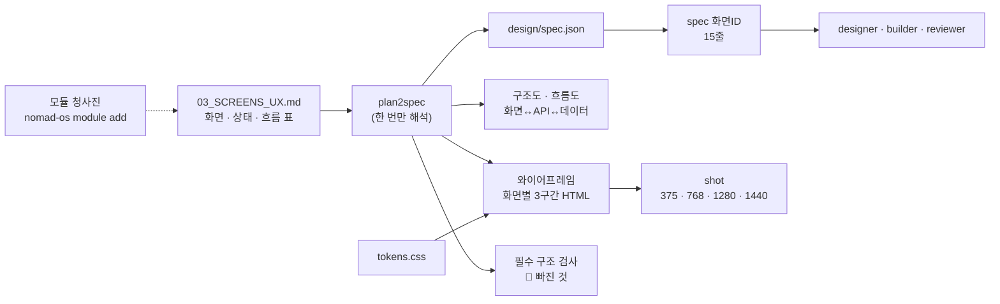

# 기획 → 구조도 · 시안 — 한 번 해석해서 끝까지

기획이 정해지면 **스크립트가** 구조도 · 흐름도 · 화면별 시안(와이어프레임)을 만들고, 화면 유형마다 **반드시 있어야 하는 구조**가 빠졌는지 검사합니다.
팀원은 기획 문서를 다시 읽지 않고, 필요한 화면 하나만 받습니다.

---

## 1. 흐름



| 단계 | 명령 | 결과 |
|---|---|---|
| 기획 표 작성 | `/plan` (또는 `nomad-os module add leadgen .`) | `docs/03_SCREENS_UX.md` |
| 해석 · 생성 · 검사 | `plan2spec` | `design/spec.json` · `docs/diagrams/*.mmd` · `design/wireframes/` · 🔴 목록 |
| 화면 하나 보기 | `spec S-03` | 구성 · 상태 · 흐름 · API · 데이터 · 시안 경로 (≈15줄) |
| 디자인 토큰 | `/design` | `tokens.css` → 미리보기 · 대비 검사 · 시안 자동 갱신 |
| 3구간 확인 | `shot design/wireframes` · `shot http://localhost:3000/x` | 스크린샷 PNG |

---

## 2. 다시 읽기를 원천적으로 막는 방법

| 전에는 | 이제는 |
|---|---|
| planner · designer · diagrammer · builder가 각자 기획 문서(수백~수천 줄)를 읽음 | `plan2spec`이 **한 번** 해석 → 팀원은 `spec <ID>` 결과(≈15줄)만 받음 |
| 구조도 · 흐름도를 모델이 그림 | 화면 표의 `다음` · 흐름 표에서 **스크립트가** 생성 (토큰 0) |
| 시안을 모델이 HTML로 씀 | 화면 표의 `구성` 블록 + 토큰으로 **스크립트가** 생성 |
| 문서가 바뀌면 처음부터 다시 | 화면마다 해시 비교 → **바뀐 화면만** 다시 생성 · `spec changed`로 바뀐 ID만 확인 |
| 같은 파일 재읽기 | (기존) readguard 훅이 차단, 바뀐 줄만 전달 |

`spec`은 기획 문서가 사양보다 새로우면 **자동으로 다시 해석**하므로, 오래된 사양을 볼 일이 없습니다.

---

## 3. 화면 표 쓰는 법

```markdown
## 화면
| ID | 화면 | 유형 | 경로 | 주된 일 | 구성 | 데이터 | API | 권한 | 다음 |
|---|---|---|---|---|---|---|---|---|---|
| S-01 | 매출 대시보드 | 대시보드 | /dashboard | 이번 달 매출 확인 | header, daterange:기간, stat:매출·주문·전월 대비, chart:일별 매출, table:최근 주문, updated, export | orders | A-01 | 로그인 | S-02 |
```
- **유형**: 대시보드 · 목록 · 상세 · 폼 · 보드 · 마법사 · 설정 · 로그인 · 랜딩 — 유형마다 필수 구조가 정해져 있습니다.
- **구성**: `블록:라벨·항목` 을 쉼표로. 블록 목록은 `~/.claude/skills/ux-patterns/SKILL.md` 2절.
- **상태 표**: 화면마다 빈 · 로딩 · 오류 · 성공. 해당 없으면 `—`, **빈 칸은 미정의로 🔴**.

### 유형별 필수 구조 (빠지면 🔴)
| 유형 | 반드시 있어야 하는 것 |
|---|---|
| 대시보드 | 핵심 지표(KPI) · 기간 선택 · 추세 차트/표 · 마지막 갱신 시각 · 상세로 들어가기 · 빈/로딩/오류 |
| 목록 | 검색 · 필터 · 표/목록 · 페이지 · 상세 이동 · 빈/로딩/오류 |
| 상세 | 제목·상태 · 뒤로/경로 · 주요 작업 · 핵심 정보 |
| 폼 | 라벨 있는 입력 · 제출 · 취소 · 로딩/오류/성공 |
| 보드 | 단계 열 · 단계 이동 · 필터 · 카드→상세 |
| 마법사 · 설정 · 로그인 · 랜딩 | 단계 표시·이전/다음 · 구역·저장 · 입력·대체 링크 · 히어로·CTA·푸터 |

권장(🟡)까지 전체 기준은 `~/.claude/skills/ux-patterns/patterns.json`. 모듈은 도메인 필수 구조를 더할 수 있습니다(예: 리드젠 대시보드는 퍼널 차트 · 채널별 CPL · 응답 지연 리드가 필수).

---

## 4. 디자인 검사

| 검사 | 명령 | 기준 |
|---|---|---|
| 색 대비 | `design-preview src/styles/tokens.css --check` | 본문 4.5:1 · 버튼 글자 4.5:1 · 입력창 경계 3:1 (라이트 · 다크 모두) |
| 토큰 우회 | `design-preview --scan src/components` | 컴포넌트의 hex · px · Tailwind 임의값 · Flutter `Color(0x…)` 0건 |
| 3구간 화면 | `shot <시안 폴더 또는 URL>` | 375 · 768 · 1280 · 1440px 페이지 가로 스크롤 없음 |
| 화면 리뷰 | reviewer `mode=design` | spec의 구성 · 상태가 화면에 다 있나 + 위 3가지 + 포커스 · 라벨 · 키보드 |

`shot`은 설치가 필요 없습니다(PC의 Chrome · Edge 사용).
