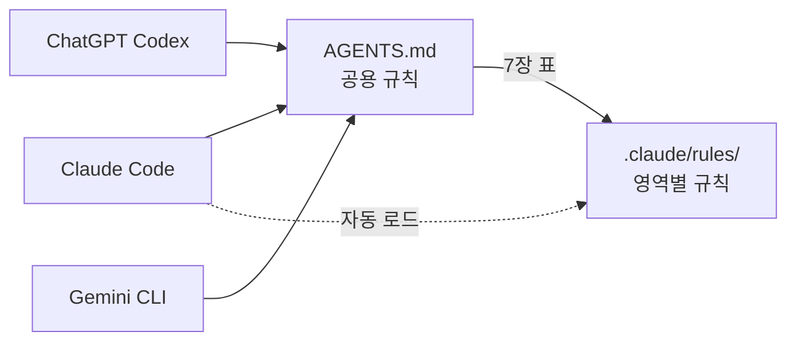

# Claude · ChatGPT · Gemini 같이 쓰기

[← README](../README.md)

## 핵심 한 줄

**규칙은 한 곳에만 쓰고, 세 도구가 같은 파일을 읽습니다.**
도구를 바꾸거나 섞어 써도 규칙이 갈라지지 않습니다.

---

## 도구별로 되는 것

| 기능 | Claude Code | ChatGPT Codex | Gemini CLI |
|---|:---:|:---:|:---:|
| 같은 규칙 (`AGENTS.md`) | ✅ | ✅ | ✅ |
| 영역별 규칙 | ✅ 자동 | ✅ 표 보고 읽음 | ✅ 표 보고 읽음 |
| 작업 목록 (`tasks/`) | ✅ | ✅ | ✅ |
| 도구 (`token-audit` 등) | ✅ | ✅ | ✅ |
| 팀 · 슬래시 명령 (`/next` 등) | ✅ | — | — |
| 반복 읽기 차단 훅 | ✅ | — | — |
| 실행 명령 | `claude` | `codex` | `gemini` |

---

## 설정 파일 위치

| | Claude Code | ChatGPT Codex | Gemini CLI |
|---|---|---|---|
| 지시 | `CLAUDE.md` | `AGENTS.md` | `AGENTS.md` |
| 설정 | `.claude/settings.json` | `.codex/config.toml` | `.gemini/settings.json` |
| 읽기 금지 | `.claude/settings.json` | `AGENTS.md` 7장 | `.geminiignore` |
| 전역 원칙 | 자동 | 설치 때 `--codex` | 설치 때 `--gemini` |

모두 `install … init`이 자동으로 만듭니다.

---

## ChatGPT · Gemini에서 일 시키는 법

슬래시 명령이 없으므로 문장으로 요청합니다.

| 하고 싶은 일 | 이렇게 요청 |
|---|---|
| 다음 작업 진행 | `AGENTS.md 6장대로 tasks/README.md의 다음 대기 작업을 진행하고 tasks/NOW.md를 갱신해줘` |
| 테스트 실행 | `q pnpm test 실행하고 실패한 것만 고쳐줘` |
| 구조도 | `deps2mmd src -o docs/diagrams/architecture.mmd 실행해줘` |
| ERD | `sql2erd supabase/migrations -o docs/diagrams/erd.mmd 실행해줘` |

---

## 주의할 점

- **규칙을 추가 · 수정할 때**는 `.claude/rules/` 파일과 `AGENTS.md` 7장 표를 **같이** 고칩니다.
  표를 빠뜨리면 ChatGPT · Gemini가 새 규칙을 모릅니다.
- **Codex 설정**(`.codex/config.toml`)은 처음 `codex`를 실행할 때 이 프로젝트를 "신뢰(trust)"로 골라야 적용됩니다.
  적용이 안 되면 같은 내용을 `~/.codex/config.toml`에 넣습니다.
- **웹 채팅**(chatgpt.com · gemini.google.com)은 파일을 직접 읽지 못합니다.
  `AGENTS.md`와 필요한 규칙 파일을 첨부해서 같은 규칙을 줍니다.
