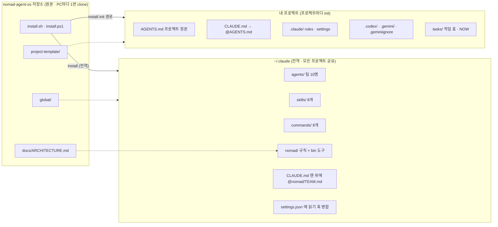
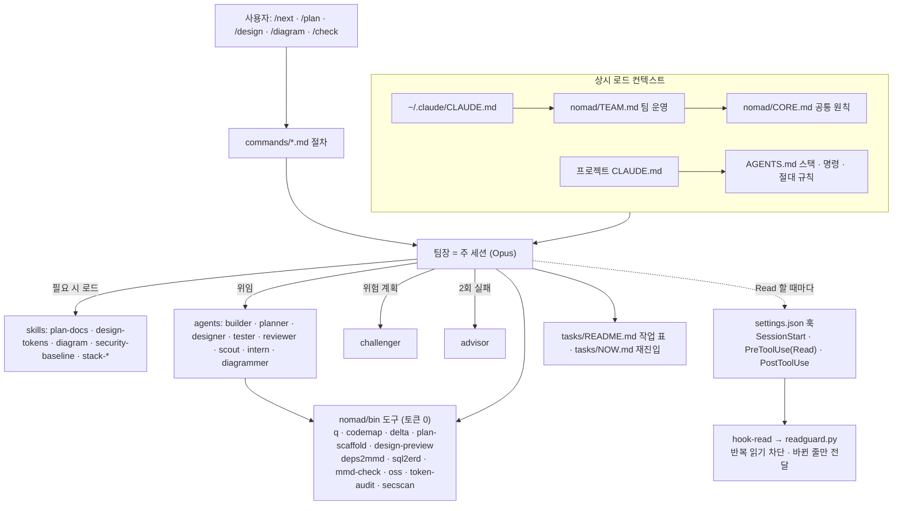

# 레퍼런스 — 명령 · 팀 · 도구 · 구조

[← README](../README.md)

- [1. 슬래시 명령](#1-슬래시-명령)
- [2. 팀](#2-팀)
- [3. 도구](#3-도구)
- [4. 구조](#4-구조)

---

## 1. 슬래시 명령

Claude Code에서 입력합니다.

| 명령 | 하는 일 |
|---|---|
| `/next` | 다음 작업 하나를 계획 → 위임 → 검증 → 커밋까지 |
| `/plan 제품명` | 린 검증 → PRD → 명세 → 작업 분해 |
| `/design` | 디자인 토큰 → 반응형 폰트 → 미리보기 |
| `/diagram 무엇` | 구조도 · 흐름도 · 시퀀스 · ERD |
| `/check` | 린트 · 타입 · 테스트를 돌리고 실패만 요약 |
| `/token-audit` | 항상 읽히는 설정의 토큰 측정 |
| `/oss 지시` | 단순 작업을 로컬 LLM(Ollama 등)에 맡김 |
| `/secure` · `/secure setup [--ci]` | 보안 점검(SBOM · 취약점 · 라이선스) / Dependabot · SECURITY.md · CI SBOM 생성 → [보안 가이드](SECURITY.md) |

---

## 2. 팀

Claude Code에서 `/agents`로 확인합니다. 팀장이 알아서 나눠 맡기므로 직접 부를 일은 거의 없습니다.

| 직급 | 팀원 | 모델 | 언제 |
|---|---|---|---|
| 고문 | advisor | Fable 5.1 | 같은 문제로 2번 실패했을 때만 |
| 팀장 | (주 세션) | Opus 5.5 | 항상 — 나누고 · 맡기고 · 판단 |
| 검증 | challenger | Opus 5.5 | 결제 · 인증 · DB 같은 위험한 계획 |
| 대리 | builder · planner · designer · tester · reviewer | Sonnet 5.5 | 구현 · 문서 · 디자인 · 테스트 · 리뷰 |
| 사원 | scout · intern · diagrammer | Haiku 5.5 | 찾기 · 반복 작업 · 그림 |

---

## 3. 도구

설치 후 새 터미널에서 이름만으로 실행합니다. PowerShell · Git Bash 모두 같은 이름입니다.
모델 대신 스크립트가 처리하므로 토큰을 쓰지 않습니다.

| 도구 | 하는 일 | 예 |
|---|---|---|
| `q` | 긴 출력 명령 실행 → 실패 줄만 표시 | `q pnpm test` |
| `codemap` | 파일 · 함수 목록 지도 | `codemap src` |
| `delta` | 바뀐 줄 · 바뀐 파일만 보기 | `delta --changed` |
| `plan-scaffold` | 기획 문서 뼈대 8개 | `plan-scaffold docs --name 쇼핑몰` |
| `design-preview` | 디자인 토큰 미리보기 HTML | `design-preview tokens.css -o design/preview.html` |
| `deps2mmd` | 코드 import → 구조도 | `deps2mmd src -o docs/diagrams/architecture.mmd` |
| `sql2erd` | SQL → ERD | `sql2erd supabase/migrations -o docs/diagrams/erd.mmd` |
| `mmd-check` | Mermaid 검증 + SVG | `mmd-check docs/diagrams/erd.mmd` |
| `oss` | 로컬 LLM에 맡기기 | `oss "3줄 요약" log.txt` |
| `token-audit` | 상시 로드 토큰 측정 | `token-audit .` |
| `secscan` | SBOM · 취약점 우선순위 · 라이선스 · 보안 설정 파일 | `secscan all .` · `secscan vuln --kev` · `secscan setup --ci` |
| `nomad-os` | 어디서든 NOMAD 설치기 실행 | `nomad-os init <프로젝트 경로>` |

`readguard` · `hook-read`는 Claude Code가 자동으로 쓰는 훅이라 직접 실행하지 않습니다.

---

## 4. 구조

### 설치 구조 — 어디에서 어디로 복사되나


### 실행 구조 — Claude Code 세션에서 무엇이 무엇을 부르나


### 파일 트리
<details>
<summary>전체 파일 트리 펼치기</summary>

```text
nomad-agent-os/
├── README.md                     # 첫 화면: 소개 · 빠른 시작 · 문서 안내
├── install.sh                    # 설치기. 인자 없으면 전역(~/.claude) 설치, `init <경로> [--name]`이면 프로젝트 적용
├── install.ps1                   # Windows PowerShell 진입점: Git Bash로 install.sh 실행 + bin-win/*.cmd 래퍼 · 사용자 PATH
├── .gitattributes                # 줄바꿈을 LF로 고정 (Windows에서 받아도 스크립트가 깨지지 않게)
├── docs/
│   ├── INSTALL.md                # 설치 · 확인 · 업데이트 · 제거
│   ├── GETTING_STARTED.md        # 기존 저장소 / 처음부터 단계별 따라하기
│   ├── MULTI_AI.md               # Claude · ChatGPT · Gemini 같이 쓰기
│   ├── REFERENCE.md              # 이 문서: 명령 · 팀 · 도구 · 구조
│   ├── ARCHITECTURE.md           # 설계서: 4개 레포 분석, 설계 원칙, 토큰 최적화 장치, 로드맵
│   └── examples/SCENEFLOW.md     # 따라하기: 기획 문서만 있는 저장소에 NOMAD 적용
│
├── global/                       # ▶ 전역 설치 원본 → ~/.claude 로 복사
│   ├── CLAUDE.md                 # 전역 CLAUDE.md 기본본 (@nomad/TEAM.md import + 개인 설정 자리). 기존 파일이 있으면 import 한 줄만 추가
│   ├── settings.nomad.json       # settings.json 에 병합할 훅 3개 (SessionStart · PreToolUse(Read) · PostToolUse → hook-read)
│   ├── agents/                   # 팀원(서브에이전트) 정의 — 직급별 모델 지정
│   │   ├── advisor.md            #   고문: 같은 문제로 2회 이상 실패했을 때만 근본 원인 진단
│   │   ├── challenger.md         #   검증: 결제 · 인증 · RLS · 마이그레이션 등 위험 계획을 착수 전 공격 (읽기 전용)
│   │   ├── builder.md            #   대리: 코드 구현 · 수정 · 리팩터링 (stack-* 스킬 먼저 읽음)
│   │   ├── planner.md            #   대리: PRD · 명세 · ADR · 작업 분해 문서의 지정 섹션 작성
│   │   ├── designer.md           #   대리: 디자인 토큰 · DESIGN.md · 컴포넌트 명세 (반응형 3구간)
│   │   ├── tester.md             #   대리: 테스트 작성 · 실행 (운영 코드는 수정 안 함)
│   │   ├── reviewer.md           #   대리: 적대적 리뷰 mode=code · contract · security · doc (읽기 전용)
│   │   ├── scout.md              #   사원: 파일 · 코드 위치 탐색, 구조 요약 (읽기 전용)
│   │   ├── intern.md             #   사원: 값 추출 · 형식 변환 · 일괄 이름 변경 같은 기계적 작업
│   │   └── diagrammer.md         #   사원: Mermaid(.mmd) 구조도 · 흐름도 · ERD 작성 + mmd-check 검증
│   ├── commands/                 # 슬래시 명령 — 사용자가 직접 부르는 절차
│   │   ├── next.md               #   /next: 다음 작업 하나를 계획 → 위임 → 검증 → 커밋까지
│   │   ├── plan.md               #   /plan: 린 검증 → PRD → 명세 → 작업 분해 (섹션 병렬 작성)
│   │   ├── design.md             #   /design: 토큰 중심 디자인 시스템 + 미리보기
│   │   ├── diagram.md            #   /diagram: 구조도 · 흐름도 · 시퀀스 · ERD 생성 · 검증
│   │   ├── check.md              #   /check: 린트 · 타입 · 테스트 실행, 실패만 요약
│   │   ├── token-audit.md        #   /token-audit: 상시 로드 토큰 측정 + 줄일 곳 제안
│   │   ├── oss.md                #   /oss: 단순 텍스트 작업을 로컬 LLM(Ollama 등)에 위임
│   │   └── secure.md             #   /secure: 보안 점검 · setup(Dependabot · SECURITY.md · CI SBOM)
│   ├── skills/                   # 스킬 — 필요할 때만 로드되는 절차 · 규약
│   │   ├── plan-docs/            #   기획 문서 절차
│   │   │   ├── SKILL.md          #     절차 본문
│   │   │   └── templates/        #     lean.md(린 검증) · prd.md · adr.md(결정 기록) · task.md(작업 1건)
│   │   ├── design-tokens/SKILL.md#   브리프 → 토큰 → 3구간 폰트 → 미리보기 → 사람 확정
│   │   ├── diagram/SKILL.md      #   Mermaid 작성 규칙 (ERD는 sql2erd 기계 생성)
│   │   ├── security-baseline/    #   보안 기본: 레벨 L0~L3 판정 + references/
│   │   │                         #     supply-chain(의존성·라이선스·SBOM) · vuln-priority(KEV·EPSS·체인·VEX)
│   │   │                         #     threat-model(기능당 위협 메모) · agent-security(AI 키·권한) · compliance(규제·표준)
│   │   ├── stack-nextjs/         #   Next.js · React · Tailwind v4 · shadcn/ui 규약
│   │   ├── stack-supabase/       #   Postgres · RLS · Auth · 마이그레이션 규약
│   │   ├── stack-fastapi/        #   FastAPI · Pydantic v2 · LLM 게이트 규약
│   │   │   ├── SKILL.md          #     (stack-* 공통) 요약 + 언제 읽나
│   │   │   └── references/       #     build-and-run.md(명령) · conventions.md(규약) · pitfalls.md(리뷰 체크리스트)
│   │   └── stack-flutter/        #   Flutter · Riverpod 3 · go_router · drift 규약 (SKILL.md + pitfalls.md)
│   └── nomad/                    # NOMAD 본체 → ~/.claude/nomad
│       ├── TEAM.md               #   팀 운영 규칙 (Claude Code 전용) — 직급 · 위임 · 검증 표. CORE.md import
│       ├── CORE.md               #   모든 AI 도구 공통 원칙 (--codex · --gemini 로 각 도구 전역 지시 파일에도 추가)
│       └── bin/                  #   도구 — 모델 대신 스크립트가 처리해 토큰 0 (PATH 등록)
│           ├── q                 #     긴 출력 명령 실행 → 실패 줄 + 꼬리 + 종료 코드만 표시
│           ├── codemap           #     파일 · export · 함수 시그니처 지도 (통독 대신)
│           ├── delta             #     마지막으로 본 뒤 바뀐 줄 / 바뀐 파일만 · 체크포인트 저장
│           ├── plan-scaffold     #     기획 문서 뼈대 8개 생성 (기존 파일 보존)
│           ├── mmd-check         #     Mermaid 문법 검증 + SVG/PNG 렌더링 (mermaid-cli)
│           ├── oss               #     OpenAI 호환 로컬 LLM에 텍스트 작업 위임
│           ├── hook-read         #     훅 → readguard 호출 래퍼 (의도적 차단 외 실패는 통과 처리)
│           ├── _py               #     파이썬 도구 공통 실행기 (Windows 파이썬 탐지 · UTF-8)
│           ├── deps2mmd · design-preview · readguard · sql2erd · token-audit · secscan   # _py 를 거쳐 py/ 실행
│           ├── (nomad-os)        #     설치 때 생성 — 저장소 위치를 기억하는 설치기 실행기
│           └── py/
│               ├── deps2mmd.py   #       import 분석 → 모듈 의존 구조도 (TS/JS · Python · Dart)
│               ├── design-preview.py #   tokens.css → 미리보기 HTML · 토큰 표 (--init 시작 토큰)
│               ├── readguard.py  #       반복 읽기 차단 훅 본체 · 바뀐 줄만 전달
│               ├── sql2erd.py    #       SQL 마이그레이션 → Mermaid ERD
│               ├── secscan.py    #       lockfile → CycloneDX SBOM · OSV 취약점(+KEV·EPSS) · 라이선스 정책 · setup
│               └── token-audit.py#       상시 로드 컨텍스트 토큰 추정 · 예산 초과 경고
│
└── project-template/             # ▶ 프로젝트 템플릿 → init 대상 폴더로 복사 (기존 파일 보존 · 병합)
    ├── AGENTS.md                 # 프로젝트 단일 정본: 스택 · 명령 · 절대 규칙 · 문서 지도 · 영역 규칙 표 (모든 AI 도구 공용)
    ├── CLAUDE.md                 # @AGENTS.md import + Claude Code 전용 메모
    ├── .gitignore                # .nomad/ · .env · node_modules/ 등 (없는 줄만 병합)
    ├── .claude/
    │   ├── settings.json         # 모델 지정 + 읽기 차단(.env · node_modules · lock 파일 · 빌드 산출물)
    │   └── rules/                # 영역 규칙 정본 — Claude는 paths로 자동 로드, ChatGPT · Gemini는 AGENTS.md 7장 표로
    │       ├── web.md            #   apps/web/**
    │       ├── api.md            #   apps/api/**
    │       ├── db.md             #   supabase/**
    │       └── docs.md           #   docs/**
    ├── .codex/config.toml        # ChatGPT Codex: 샌드박스(workspace-write) · 승인(on-request) — 신뢰한 프로젝트에서 적용
    ├── .gemini/settings.json     # Gemini CLI 가 AGENTS.md (+ 전역 GEMINI.md) 를 컨텍스트로 읽게 설정
    ├── .geminiignore             # Gemini CLI 읽기 제외 (.env · lock · 빌드 산출물, 없는 줄만 병합)
    └── tasks/
        ├── README.md             # 작업 표 (번호 · 웨이브 · 선행 · 위험도 · 담당 · 상태) + 발견한 문제 · 교훈
        └── NOW.md                # 재진입 스냅샷 30줄 — /next 가 매 작업 끝에 덮어씀
```
</details>
